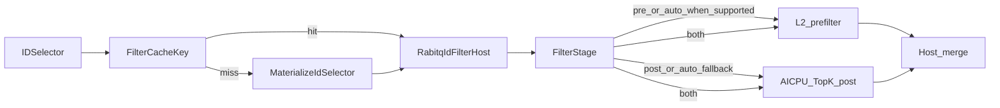

# IVF-RabitQ支持IDSelector过滤检索技术方案设计(RFC)

**状态 (Status):** Draft
**作者 (Authors):** @duliqiang
**创建日期 (Created):** 2026-08-24
**更新日期 (Updated):** 2026-10-27

---

# 1. 概述

## 1.1 简介

本提案在既有 **AscendIndexIVFRaBitQ** 检索能力之上，对齐 FAISS 的 `SearchParameters.sel`（`IDSelector`）语义，支持在检索阶段按向量 ID 过滤结果。

IVF-RabitQ 主体算法（训练、入库、L1/L2、LUT、Refine 等）见主 RFC：
[IVF-RabitQ检索算法技术方案设计(RFC).md](./IVF-RabitQ检索算法技术方案设计(RFC).md)。本文只写 **ID 过滤检索**：过滤结构的生成与缓存、单次 `nprobe`、`IDSelectorArray` 与 `IDSelectorRoaring`，以及 L2 前置和 AICPU 后置的阶段选择。

本文记录 **as-implemented** 方案。公开接口仍是 `search(..., const SearchParameters *params)`。基类读取 `params->sel`。传入 `SearchParametersIVF` 时，再读取本次 `nprobe`。过滤阶段由环境变量 `IVFRABITQ_SELECTOR_FILTER_STAGE` 决定，不放进 `SearchParameters`。

### 核心特性

- **接口兼容**：复用 FAISS `search(..., const SearchParameters *params)`，通过 `params->sel` 传入过滤器；`params == nullptr` 或 `sel == nullptr` 时不过滤，行为与改造前一致。
- **阶段可选**：默认 `auto`。L2 距离算子能判断该 ID 是否在过滤集里，就只在算距离前过滤；否则只在 AICPU TopK 入堆前过滤。`post` 只做后置。`both` 只有前置实际打开时才滤两次。Roaring、没有前缀表的有序 ID 和 SIMT 上，`both` 仍然只后置。
- **L2 前置**：普通距离 kernel 上，稠密 bitmap、区间和带前缀表的有序 ID 按段过滤。整段都未选中，就跳过这段距离。段内有向量选中时仍计算整段，未选中向量的距离写成哨兵值（L2 为最大浮点数，内积为最小浮点数），进不了 top-k。
- **AICPU 后置**：Roaring，以及不能在 L2 里判断成员的路径，在 TopK 入堆前判断 ID 是否保留。
- **多卡一致**：Host 侧把过滤器转成一份全局结构（下文称物化）。各卡用同一份结构过滤本地候选，再在 Host 合并 top-k。
- **查询期缓存**：Host 有两个槽，命中时复用已经物化的结果。Device 命中时复用已经拷到设备上的数据，跳过重复的 Host 到 Device 拷贝（H2D）。
- **单次 nprobe**：传入 `SearchParametersIVF` 时，`nprobe` 仅对本次查询生效（须 `> 0` 且 `<= nlist`），不改 index 上的 `nprobe`。

## 1.2 动机

### 背景

FAISS 生态广泛使用 `IDSelector` 在检索时限定候选 ID（白名单 / 黑名单 / 区间）。业务侧常见需求包括：仅检索某一用户子集、排除已曝光 ID、按 ID 区间分片查询等。稀疏 ID 集或长连续段用稠密 bitmap 浪费内存，需要压缩位图。

### 痛点

- 改造前 `AscendIndexIVFRaBitQ::search` 未读取 `params->sel`，无法与 FAISS CPU 过滤检索对齐。
- 若依赖 `remove_ids` 永久删库，无法满足「单次查询临时过滤」场景。
- TS 路径的 AttrFilter 面向属性表达式，与「按向量 ID 过滤」语义不同，无法直接复用。
- 改造前每次 `search` 都在 Host 物化 `IDSelector`，并每次把数据拷到 Device。稠密 Array/Batch 走排序列表和二分查找。亿级底库上，物化和拷贝的开销远大于后置过滤判断本身。
- 只在 TopK 后置过滤时，L2 仍对 probed lists 内全部候选算距离。bitmap / range / 有序 ID 可以在 L2 提前丢掉未选中 ID。
- FAISS 自带 `IDSelectorBitmap` 是稠密字节位图。稀疏或长 run 的 keep 集需要 CRoaring。

### 价值

- 与 FAISS 过滤检索语义对齐，降低业务迁移成本。
- 过滤为查询期临时物化，不污染底库、不增加常驻底库 mask（Device 仅缓存最近一次 payload，以及 SORTED 的前缀表副本）。
- Roaring 覆盖稀疏集和长连续段；稠密 bitmap 仍走移位判断，不把 `IDSelectorBitmap` 自动转成 Roaring。
- 能走 L2 前置的选择器在 `auto` 下不再把成员判断留到 TopK；Roaring 保持后置，避免在距离算子里做 `roaring_bitmap_contains`。

## 1.3 目标

### 目标

- 支持通过 `SearchParameters.sel` 传入：
  - `IDSelectorRange` / `IDSelectorBatch` / `IDSelectorArray` / `IDSelectorBitmap`
  - `faiss::ascend::IDSelectorRoaring`（CRoaring frozen 字节或 live `roaring_bitmap_t*`）
  - 以及上述类型的 **单层** `IDSelectorNot`
- 传入 `SearchParametersIVF` 时，本次 `nprobe` 覆盖 index 上的 `nprobe`（不写回 index）。
- 多卡场景下同一全局 ID selector 应用于每张卡，Host 合并结果。
- 保持无过滤检索路径兼容；精度与 CPU 过滤检索基线可对齐（见 UT）。
- `uint32` 内的 Array / Batch：连续步长 1 收成 `RANGE`，否则优先 freeze 成 `ROARING`；失败再回退稠密 bitmap 或排序列表。
- Host 两槽、Device payload 缓存命中时跳过重复物化与 H2D。
- `IVFRABITQ_SELECTOR_FILTER_STAGE` 支持 `auto` / `pre` / `post` / `both`。

### 非目标

- L2 前置只做 bitmap / range / sorted-prefix 的成员判断。Roaring 不进 L2。SIMT（Ascend 950）不做 L2 前置。
- 不做底库侧持久化 filter mask / list prune。
- 不支持 `IDSelectorAnd` / `IDSelectorOr` 等复合选择器，以及嵌套多层 `IDSelectorNot`。
- `IDSelectorBitmap` 保持稠密字节位图，不自动转成 Roaring。
- `IDSelectorRoaring` 只寻址 `uint32` ID。

### 平台支持

- **Atlas A2 推理系列产品 / Atlas A3 推理系列产品**：支持。普通距离 kernel 可做 L2 前置。
- **Ascend 950PR 系列产品**：支持检索与 AICPU 后置过滤。距离走 SIMT kernel，不做 L2 前置。`auto` 退回后置；显式 `pre` 返回参数错误。
- 后置过滤依赖 AICPU TopK。

---

# 2. 用例分析

## 2.1 功能需求

| 场景 | 输入 | 期望行为 |
|------|------|----------|
| 无过滤 | `params == nullptr` 或 `sel == nullptr` | 与改造前 search 一致 |
| Range | `IDSelectorRange(imin, imax)` | 仅返回 `[imin, imax)` 内 ID |
| Batch | `IDSelectorBatch` | 仅返回集合内 ID。全是 `uint32` 且为连续区间时物化成 `RANGE`；否则优先 `ROARING` |
| Array | `IDSelectorArray` | 仅返回数组内 ID。步长 1 收成 `RANGE`，可 L2 前置；其它 `uint32` ID 优先 `ROARING`，只后置。路径见 §3.7 |
| Bitmap | `IDSelectorBitmap` | 按位图置位 ID 返回；FAISS `n` 为 bitmap **字节长度**（合法 ID ∈ `[0, n*8)`）。不转成 Roaring |
| Roaring | `faiss::ascend::IDSelectorRoaring` | frozen 字节或 live `roaring_bitmap_t*`。只接受 `uint32` ID |
| Not | `IDSelectorNot` 包裹上述之一 | 对 membership 取反 |
| 单次 nprobe | `SearchParametersIVF` 且 `nprobe > 0` | 本次 L1 probe 数用该值；不改 `index.getNumProbes()` |
| 阶段 `auto` | 未设置环境变量，或值为 `auto` | 能走 L2 前置则只前置；否则只后置 |
| 阶段 `pre` | `IVFRABITQ_SELECTOR_FILTER_STAGE=pre` | 仅 L2 前置。Roaring、无前缀表的 SORTED、SIMT 返回参数错误 |
| 阶段 `post` | `post` 或 `postfilter` | 仅 AICPU TopK 后置；距离侧 filter 属性为 0 |
| 阶段 `both` | `both` | L2 能走则前置，同时 AICPU 再滤一次。用于对比 |
| 多卡 | 设备列表 ≥ 2 | 各卡同一 selector，Host merge top-k |
| 不足 k | 过滤后候选不足 | 结果以 `-1` 填充（与 FAISS 习惯一致） |
| Array/Bitmap/Roaring wrap | 同一 buffer 或同一 live 指针上新建包装器 | payload 键命中，不重新物化、不重复 H2D |
| Range/Batch wrap | 新对象、内容相同 | 对象键未命中，重新物化（Range 很轻；Batch 需要重新扫描集合） |

环境变量只认小写。`prefilter` 与 `pre` 相同，`postfilter` 与 `post` 相同。其它值打一条警告并退回 `auto`。`POST` 不会当成 `post`。

## 2.2 约束说明

- **阶段**：默认 `auto`。在 A3 / 910B 的普通距离 kernel 上，bitmap、range、sorted-prefix 只在 L2 过滤，TopK 不再判断成员。Roaring 在 `auto` 下只走 AICPU 后置。SIMT（Ascend 950）不能做 L2 前置，`auto` 自动改为后置。显式 `pre` 又不能前置时，返回参数错误。Roaring 在支持 L2 的芯片上设 `pre`，也是参数错误，因为 Roaring 不能交给 L2。
- `both`：只有 L2 前置实际打开时，同一批候选才会滤两次。它是对比开关，不是默认路径。Roaring、没有前缀表的有序 ID 和 SIMT 上，`both` 只做后置。
- **Bitmap**：对齐 FAISS `IDSelectorBitmap`。`n` 是 bitmap 的字节数。`is_member` 用 `(id >> 3) >= n` 判断越界，合法 ID 范围是 `[0, n*8)`。Host 物化时直接引用用户缓冲区，不拷贝。`aux0 = n * 8`，作为 bit 个数上限，供 Device 做边界检查。
- **Roaring**：`faiss::ascend::IDSelectorRoaring`。frozen 缓冲必须由 SDK 内 CRoaring 5.0.0 的 `roaring_bitmap_frozen_serialize` 生成。`aux0` 是 frozen 字节长度，不是 bit 个数。`roaring_bitmap_frozen_view` 要求 32 字节对齐（`RABITQ_ROARING_FROZEN_ALIGN`）。未对齐时，`is_member` 在选择器对象内拷一份对齐副本。Device 侧 H2D 另分配 `payloadBytes + 32`，对齐后再拷贝。负 ID 或大于 `UINT32_MAX` 的 ID 视为不在集合内。`negate` 时这些 ID 仍然保留。
- **Array / Batch 物化顺序**（Array 的分块与等差数列见 §3.7；Batch 的区间判定留在本节）：
  1. 空集收成 `RANGE [0, 0)`。
  2. Array 若是步长 1 的等差数列且首尾落在 `uint32`，收成 `RANGE [first, first+n)`。Batch 若全部 ID 落在 `uint32` 且 `max - min + 1 == set.size()`，收成 `RANGE [min, max+1)`。
  3. 其余 ID 都落在 `uint32`：Array 对步长大于 1 的等差数列走 `roaring_bitmap_from_range`，其它走分块 `add_range` / `add_many`；Batch 排序后同样 freeze。freeze 前对自建 bitmap 做 `roaring_bitmap_run_optimize`。
  4. 出现负 ID 或 `id > UINT32_MAX`，或 freeze 失败：回退两遍扫描。`PreferBitmap` 为真则 `BITMAP`，否则 `SORTED` 并附带前缀表。
- `PreferBitmap`**（仅回退路径）**：无负 id、`maxId >= 0`、`nIds > 0`、`bitmapBytes <= 128MB` 且 `bitmapBytes <= sortedBytes`。128 MB 上界覆盖约 1.07e9 个 ID。
- **SORTED 前缀表**：回退成 `SORTED` 且没有负 ID 时，Host 另建 `sortedPrefixPayload`（默认前缀桶不超过 2^16）。Host 主 `mode` 仍是 `SORTED`。L2 前置把它写成 `SORTED_PREFIX`。有负 ID 时不建前缀表，因此不能 `pre`。
- **Host 缓存**：两个槽（`kFilterCacheSlots = 2`），由 `filterCacheMutex` 保护。传入 selector 时，锁持有到本次 `search` 返回。Array、Bitmap、Roaring，以及它们外面再包一层 `IDSelectorNot`，按数据指针和长度命中，不比较内容。Roaring live 的键是 live 指针，且 `n = 0`。frozen 的键是 `(frozen 指针, n)`。Range 和 Batch 按选择器对象指针命中。Range 还会把 `imin`、`imax` 放进键，所以同一个对象改了区间会未命中，然后重新物化。两个槽都占用时，淘汰较久未用的那一槽。`addImpl` 和 `deleteImpl` 调用 `InvalidateFilterCache()`，清空两槽并递增 `generation`。
- **Device 缓存**：主 payload 在 `src`、`payloadBytes`、`mode`、`negate`、`aux0`、`aux1`、`generation` 全部一致时跳过 H2D。Roaring 的设备指针按 32 字节对齐。SORTED 前缀表走单独的 device 缓冲，按源指针、字节数和 `generation` 复用。Range 的 `payloadBytes()==0`，不走 H2D。`reset()` / `addVectors` / `removeIds` 调用 `ClearCachedFilterPayload()`。
- **生命周期**：`IDSelector` 以及 Array / Bitmap / Roaring 引用的 ids、bitmap、frozen 字节、live `roaring_bitmap_t`* 须在 `search` 返回前保持有效。缓存期内不要原地修改这些 buffer（键只比指针和长度，不比内容）。live bitmap 首次 miss 会拷贝再冻结；之后命中的是那份冻结结果，改 live 内容不会更新设备副本。
- **nprobe**：传入 `SearchParametersIVF` 时读取 `nprobe`。它必须大于 0，不超过 `numeric_limits<int>::max()`，也不超过 `nlist`。这个值只作为本次查询的 L1 `probeK`。只用基类 `SearchParameters` 做过滤时，仍然用 index 上的 `nprobe`。FAISS 里 `SearchParametersIVF.nprobe` 的默认值是 **1**。只想过滤、不想改探测数时，继续用基类，或把它设成 `index.getNumProbes()`。`int` 上界是因为 `searchNprobe` 以 `int` 下传。正常 `nlist` 远小于这个上界。超大输入会先报 `"exceeds int range"`。
- **不支持类型**：抛出明确错误：
`AscendIndexIVFRaBitQ search IDSelector only supports Range/Batch/Array/Bitmap/Roaring and IDSelectorNot of them`

## 2.3 验收

| 类型     | 位置                                                                                                                                  | 覆盖点                                                                                                                                                                                                                                                                                                                                                                                                                                                                                                                                                                                                                                                                              |
| ------ | ----------------------------------------------------------------------------------------------------------------------------------- | -------------------------------------------------------------------------------------------------------------------------------------------------------------------------------------------------------------------------------------------------------------------------------------------------------------------------------------------------------------------------------------------------------------------------------------------------------------------------------------------------------------------------------------------------------------------------------------------------------------------------------------------------------------------------------- |
| UT     | `feature_retrieval/src/ascendfaiss/ut/TestAscendIndexUTIVFRabitQ.cpp`                                                               | `IDSelectorRoaringIsMember`：live、对齐 frozen、未对齐 frozen 的 `is_member`。 `SearchWithIdSelector`：Range、Batch、Bitmap、`Not(Range)`；稀疏 Array；步长 2 的 `IDSelectorRoaring`；非等差 Array；live 与 frozen Roaring，以及 `Not(live)`。 `SearchWithIdSelectorOutOfUint32`：超出 `uint32` 的 Array 仍只返回允许集合内的 ID。不断言物化 mode。 `SearchWithIdSelectorSharedPayload`：打桩 `searchImpl`，只断言过滤后的 label。覆盖同一 Array、Batch、Bitmap、Roaring live、Roaring frozen 上的两个包装器，以及同一份 Array 的两个 `IDSelectorNot`。不断言 generation，也不证明缓存槽被复用。 `SearchWithIdSelectorMultiDevice`：多卡。设备数不足时 skip。 `SearchParametersIVFNprobe`、`SearchParametersIVFInvalidNprobe`：单次 nprobe 与非法值。 `auto`、`pre`、`post`、`both` 目前没有单测，以 `searchImplL2` 为准。 |
| API 文档 | `docs/zh/api/02_approximate_retrieval/16_AscendIndexIVFRaBitQ.md`、`docs/en/api/02_approximate_retrieval/16_AscendIndexIVFRaBitQ.md` | 支持类型、Roaring 生命周期、`IVFRABITQ_SELECTOR_FILTER_STAGE`、缓存约束、单次 nprobe                                                                                                                                                                                                                                                                                                                                                                                                                                                                                                                                                                                                               |
| 性能与资源  | 本文 §2.4、§3.5                                                                                                                        | 正式门槛。场景、损耗上限、内存上限、72 小时稳定性和多卡要求见 §2.4。测试步骤见 §2.5                                                                                                                                                                                                                                                                                                                                                                                                                                                                                                                                                                                                                                 |

## 2.4 性能与资源需求

正确性、时延、内存、稳定性和多卡都按下面的标准验收。

- **正确性与召回**：用过滤之后的底库构造真实 TopK。返回的有效 ID 都必须满足过滤条件。召回率相对这份真实 TopK 计算。
- **结果不足**：覆盖 `nprobe < topk`，并且过滤后有效候选少于 TopK 的查询。空位 ID 为 `-1`。`nprobe` 是本次探测的倒排列表数。它小于 `topk` 本身不会必然导致结果不足。
- **时延**：A3 单卡 2 die。底库 6 亿，维度 128，`nlist=32768`，`nprobe=256`，`topk=1000`。`IDSelectorBitmap` 保留 50% 的 ID。只考察同一个选择器的缓存命中。性能损耗不超过 15%，挑战目标不超过 5%。
- **内存**：过滤功能引入的增量内存不超过索引总大小的 5%。
- **稳定性**：持续压测 72 小时，无内存泄漏。
- **多卡**：单卡和多卡（A3 16 die）都能正常检索。验证结果正确，并验证资源释放。

## 2.5 测试设计

### 2.5.1 正确性与召回

在过滤后的 ID 集合上构造真实 TopK，作为对照。

1. 用同一份查询，分别做无过滤检索和带 `IDSelector` 的检索。
2. 带过滤的结果里，每个不是 `-1` 的 ID 都必须属于该选择器。
3. 用过滤后的真实 TopK 计算召回率。

### 2.5.2 结果不足 TopK

构造两组查询：

- `nprobe < k`，并且过滤后有效候选少于 `k`。空位 ID 必须是 `-1`。
- `nprobe < k`，但是过滤后有效候选仍然不少于 `k`。这组用来确认不能只根据 `nprobe < k` 判断结果不足。

### 2.5.3 性能测试方法

热路径复用同一个 `IDSelectorBitmap`，保留 50% 的 ID。

报告至少记录：批量大小、并发、预热次数、循环次数、统计量（至少包含平均时延）。

测试程序参考 `examples/TestAscendIndexIVFRaBitQIdSelectorPerf.cpp`。它的当前做法是：默认 2 die、底库 6 亿、`nlist=32768`、`nprobe=256`、`topk=1000`、保留比例 0.5、预热 5 次、循环 20 次。时延损耗按过滤检索的平均时延相对无过滤检索计算。内存增量按 Host RSS 增量加 Device HBM 增量，再除以索引占用的 HBM。

### 2.5.4 内存、稳定性与多卡

- 内存：记录过滤前后的 Host RSS 和各 die 的 HBM。增量不超过索引总大小的 5%。
- 稳定性：按 §2.4 的时延场景持续检索 72 小时。开始和结束时记录 RSS 与各 die HBM，确认没有泄漏。
- 多卡：单卡，以及 A3 16 die。两组都检查过滤结果正确。索引释放后，设备内存回到建索引之前。

---

# 3. 方案设计

## 3.1 技术选型

可选路径对比：

| 方案 | 做法 | 优点 | 缺点 | 结论 |
|------|------|------|------|------|
| A. 全部过滤放进 AscendC L2 | 距离算子侧跳过非成员，含 Roaring | 可省部分算力 | Roaring 查找不适合距离关键路径；SIMT 要分叉 | 不采用为唯一路径 |
| B. 底库持久 mask | 建库/更新时维护可检索集合 | 高过滤比友好 | 语义变成「改库」；内存与一致性成本高 | 不采用 |
| **C. 按选择器分阶段** | bitmap / range / sorted-prefix 可 L2 前置；其余 AICPU TopK 后置 | 与 L1 解耦；Roaring 留在 CPU；`auto` 按能力选择 | 高过滤比且不能前置时仍算满 L2；`both` 会滤两次 | **采用** |

bitmap、range、sorted-prefix 可以在 L2 前置过滤。Roaring 只走 AICPU 后置。

## 3.2 总体数据流



说明：

1. Host 将 FAISS `IDSelector` 按缓存键查找；miss 时物化为设备无关结构 `RabitqIdFilterHost`。
2. `searchImplL2` 读 `IVFRABITQ_SELECTOR_FILTER_STAGE`，再看该 mode 能否设 L2 的 `requestedDistSelMode`，以及 `IsRabitqL2PrefilterKernelSupported()`（A5/950 SIMT 为 false）。
3. 需要 payload 时 `EnsureFilterPayloadOnDevice`；`both` 且 mode 为 bitmap 时，L2 与 TopK 共用同一次 H2D 得到的设备指针。SORTED 前缀表单独 `EnsurePrefixFilterPayloadOnDevice`。
4. L2 与 AICPU TopK 在两条 stream 上重叠。端到端时间是两者的最大值。后置关闭时，TopK 的 sel mode 为 `NONE`。
5. 多卡结果在 Host 按距离合并为最终 top-k。
6. 若开启 Refine，精排拿到的是过滤之后的候选。后置路径的过滤发生在 TopK，不发生在距离算子里。

## 3.3 能力底座

### 3.3.1 对外接口

```cpp
void search(idx_t n, const float *x, idx_t k,
            float *distances, idx_t *labels,
            const SearchParameters *params = nullptr) const override;
```

- 读取 `params->sel`。
- 若 `dynamic_cast<const SearchParametersIVF*>(params)` 成功，再读取本次 `nprobe`。它必须大于 0，不超过 `numeric_limits<int>::max()`，也不超过 `nlist`。该值经 `searchWithSelector(..., searchNprobe)` 传到 L1 `probeK`。`searchNprobe == 0` 时，Daemon 回退到 index 上的 `nprobe`。`int` 上界是防御性校验，因为 `searchNprobe` 以 `int` 传递。超大值先抛 `"SearchParametersIVF.nprobe exceeds int range"`。
- 实现入口：`AscendIndexIVFRaBitQ` → `AscendIndexIVFRaBitQImpl::searchWithSelector`。
- 过滤阶段不在 `SearchParameters` 里，见 §3.9。

### 3.3.2 Host 物化：`RabitqIdFilterHost`

定义于 `feature_retrieval/src/ascendfaiss/common/RabitqIdFilter.h`：

| 字段 | 含义 |
|------|------|
| `mode` | `NONE / RANGE / SORTED / BITMAP / ROARING`。`SORTED_PREFIX` 不是 Host 主 mode |
| `negate` | 非 0 表示对 membership 取反（来自 `IDSelectorNot`） |
| `aux0` / `aux1` | RANGE: `[imin, imax)`；SORTED: 有序数组长度；BITMAP: bit 容量（FAISS `n` 为字节数，故 `aux0 = n * 8`）；ROARING: frozen 字节长度 |
| `sortedIds` / `bitmap` | 自有 payload。Roaring 的冻结结果也放在 `bitmap` |
| `sortedPrefixPayload` | SORTED 回退路径的前缀表，供 L2 `SORTED_PREFIX` |
| `bitmapView` / `viewBytes` | Bitmap 或用户传入的 Roaring frozen：挂用户 buffer；H2D 打该指针 |
| `sortedView` | 预留字段，当前物化路径始终置空 |
| `generation` | Host 重新物化或 `InvalidateFilterCache` 时递增；Device 缓存键的一部分 |
| `payloadSrc()` / `payloadBytes()` | Device 侧拷贝源与字节数；RANGE 为 0。BITMAP 与 ROARING 共用 bitmap 视图分支 |

当前物化见 §3.4.6。AICPU 后置按上面的 mode 做成员判断。

### 3.3.3 Daemon 与 AICPU attrs

`kernel_shared_def.h` 中扩展：

```text
TOPK_IVF_RABITQ_ATTR_SEL_MODE_IDX
TOPK_IVF_RABITQ_ATTR_SEL_PTR_IDX
TOPK_IVF_RABITQ_ATTR_SEL_AUX0_IDX
TOPK_IVF_RABITQ_ATTR_SEL_AUX1_IDX
TOPK_IVF_RABITQ_ATTR_SEL_NEGATE_IDX
```

`RabitqIdFilterMode`：

| 枚举 | 值 | 语义 |
|------|----|------|
| `RABITQ_ID_FILTER_NONE` | 0 | 不过滤 |
| `RABITQ_ID_FILTER_RANGE` | 1 | `[aux0, aux1)` |
| `RABITQ_ID_FILTER_SORTED` | 2 | `ptr → int64[aux0]`，二分查找。AICPU 后置使用 |
| `RABITQ_ID_FILTER_BITMAP` | 3 | `ptr → uint8[]`，按 bit；`aux0` 为 bit 容量（8 的倍数） |
| `RABITQ_ID_FILTER_SORTED_PREFIX` | 4 | L2 前置专用。`ptr` 指向 `RabitqSortedPrefixPayloadHeader` + 有序 ID + 前缀桶偏移。Host 物化主 mode 仍是 `SORTED` |
| `RABITQ_ID_FILTER_ROARING` | 5 | `ptr →` frozen CRoaring 字节，`aux0` 为字节长度。只用于 AICPU 后置 |

L2 距离算子另收 5 元 `filter_attrs`：`[mode, ptr, aux0, aux1, negate]`。能打开的 mode 只有 `BITMAP`、`RANGE`、`SORTED_PREFIX`。

`IndexIVFRaBitQ::searchImplL2` 按 §3.9 决定把 filter 写进 L2、TopK，或两边。某一侧关闭时，该侧 mode 为 `NONE`。

### 3.3.4 TopK late-filter

`TopkIvfRabitqfP32CpuKernel` 仅在后置打开时做成员判断：

1. `NONE` → 恒 true
2. `RANGE` → `id ∈ [aux0, aux1)`
3. `SORTED` → `binary_search`
4. `BITMAP` → 距离能进堆的候选再做位测试；指针非空时走 `RunBitmapQueries`（16 一组预取 bitmap 字节）。负 id 转成无符号后与 `id >= nbits` 一样视为该 bit 不存在。`negate` 时范围外的 id 仍然保留
5. `ROARING` → 用 `roaring_bitmap_frozen_view` 建视图，再 `roaring_bitmap_contains`。`id < 0` 或 `id > UINT32_MAX` 时，未取反为 false，取反为 true

每个 mode 的谓词只取反一次。`DoCompute` 在组谓词时处理 `negate`，后面不再对结果取反。`RANGE`、`SORTED`、`ROARING`，以及空 bitmap 指针，走 `ComputeQuery`。距离已经差于当前堆顶，就跳过这个候选，不再读 ID，也不做成员判断。`BITMAP` 且指针非空才走 `RunBitmapQueries`。

非法 `selMode`、`negate` 非 0/1、SORTED/BITMAP/ROARING 的 ptr/aux 不合法时，AICPU 在 attr 校验阶段报错。未选中的候选不进入 top-k。

### 3.3.5 多卡与 Refine

- **多卡**：`searchImplFiltered` 对各 device 传入同一 `RabitqIdFilterHost`*；membership 按 **全局 ID** 语义；最终 `mergeSearchResult` 与无过滤路径一致。同一条全局 ID 只落在一张卡上。
- **Refine**：L2 / TopK 已经带 filter，Refine 输入为过滤后的候选，无需二次 ID 过滤逻辑。

## 3.4 物化与缓存

Array 见 §3.7，Batch 见 §3.4.2 与 §3.8.2。两者都优先收成 RANGE 或 Roaring。Host 缓存为两槽。用户传入的 Bitmap 零拷贝。`contentHash` 不比较缓冲区内容。SORTED 回退路径附带前缀表。`SearchParametersIVF.nprobe` 只对本次查询生效。

### 3.4.1 `PreferBitmap`

只在 Roaring / RANGE 都没有收下时使用：

```text
bitmapBytes = maxId / 8 + 1
sortedBytes = nIds * sizeof(int64_t)
PreferBitmap ⇔ 无负 id 且 maxId >= 0 且 nIds > 0
              且 bitmapBytes <= 128MB
              且 bitmapBytes <= sortedBytes
```

128 MB 上界覆盖约 1.07e9 个 ID。失败时回退 SORTED，并为非负 ID 构建前缀表。

### 3.4.2 Array / Batch 当前顺序

Array 的分块、等差数列和阶段见 §3.7。这里只保留与 Batch 共用的顺序。`MaterializeFromIds`（Array）/ `MaterializeFromIdSet`（Batch），`ntotal` 参数已不参与分配：

1. 空集 → `RANGE [0, 0)`。
2. 步长 1 的连续 `uint32` 区间 → `RANGE`。Array 要求输入本身是步长 1 的等差数列；Batch 只看集合覆盖的闭区间长度是否等于元素个数。
3. 其余 ID 均落在 `[0, UINT32_MAX]` → `FreezeRoaringIdxs` / `FreezeRoaringUint32Sorted`，mode 为 `ROARING`，payload 在 Host 自有 `bitmap`。
4. 任一 ID 超出 `uint32`、或 freeze 失败 → `resetKeepCapacity()` 后两遍扫描：`PreferBitmap` 成功则 `BITMAP`，否则 `SORTED` + 前缀表。

`resetKeepCapacity()` 清空逻辑字段但保留 vector 容量与 `generation`。

### 3.4.3 Bitmap 零拷贝

物化用户传入的 `IDSelectorBitmap` 时只挂 `bitmapSel->bitmap` 到 `bitmapView`，不再 `assign` 到 Host vector。H2D 打用户 buffer。因此：

- wrap（同一 buffer、新包装器）不再付 Host 拷贝；
- content（内容相同、地址不同）只剩一次 bitmap H2D。

`IDSelectorBitmap` 不会转成 Roaring。`sortedView` 当前未使用。

### 3.4.4 Host 两槽 payload 缓存

`searchWithSelector` 在 `sel != nullptr` 时持有 `filterCacheMutex`，直到本次 search 返回，再取 `getCachedFilter(sel)`。槽位数 `kFilterCacheSlots = 2`。命中时更新 `filterSlotLru`。未命中时先用空槽。两个槽都满，则淘汰 `1 - filterSlotLru`，也就是另一槽。

`FilterCacheKey`（`AscendIndexIVFRaBitQImpl.h`）：

| 选择器 | kind | 命中条件 |
|--------|------|----------|
| `IDSelectorArray`（含外包一层 Not） | Array | `(ids 指针, n, negate)`；`contentHash` 恒为 0 |
| `IDSelectorBitmap`（含外包一层 Not） | Bitmap | `(bitmap 指针, n, negate)`；`contentHash` 恒为 0 |
| `IDSelectorRoaring` live（含外包一层 Not） | Roaring | `(live 指针, n=0, negate)` |
| `IDSelectorRoaring` frozen（含外包一层 Not） | Roaring | `(frozen 指针, n, negate)` |
| Range | Object | 选择器对象指针 + negate；`contentHash = imin`，`n = imax` |
| Batch / 其他 | Object | 选择器对象指针 + negate |

`FilterCacheKey::contentHash` 字段仍保留，并参与 `IsFilterCacheHit` 比较。Array、Bitmap、Roaring 不比较缓冲区内容，`contentHash` 固定为 0。Range 把 `imin` 放在 `contentHash`，把 `imax` 放在 `n`。同一个 Range 对象改了区间，会未命中。

同一份保留集缓冲区，或同一个 live 指针上，每次新建包装器都不会重新物化。Range 和 Batch 换了新对象就会未命中。两个槽可以同时记住两套不同的保留集。第三套会淘汰较久未用的那一槽。

`addImpl` / `deleteImpl` 以及对外的 `invalidateFilterCache()` 调用 `InvalidateFilterCache()`：清空两槽并递增 `generation`。

### 3.4.5 Device payload 缓存

`IndexIVFRaBitQ` 用常驻 `DeviceVector<uint8_t>` 替代每次 search 的临时 tensor。`EnsureFilterPayloadOnDevice` 在下列全部一致时复用 device 指针：

`src`、`payloadBytes`、`mode`、`negate`、`aux0`、`aux1`、`generation`

Roaring 分配 `payloadBytes + 32`，拷贝到 32 字节对齐地址，缓存命中返回的也是对齐后的指针。`generation` 防止 Host 对同一 `src` 重新物化后 Device 仍复用旧 payload。Range 的 `payloadBytes()==0`，不走 H2D。

SORTED 前缀表用另一块 `cachedPrefixFilterPayload`，命中条件是源指针、字节数和 `generation`。`reset()`、`addVectors`、`removeIds` 调用 `ClearCachedFilterPayload()`，两块都清。

Host 是两槽，Device 主 payload 和前缀表各只有一份，都只记住最近一次。同一份 payload 的 Host 命中且源指针与 `generation` 未变时，Device 也命中。两套已经留在 Host 槽里的选择器交替检索时，Host 可以都命中，Device 仍会按最近一次来回 H2D。

### 3.4.6 当前物化映射

| FAISS 类型 | 当前 mode | 物化要点 |
|------------|-----------|----------|
| `IDSelectorRange` | `RANGE` | 只写 `imin` / `imax`，无 payload。可 L2 前置 |
| `IDSelectorBatch` | 连续 `uint32` 区间为 `RANGE`；否则优先 `ROARING`；再否则 `BITMAP` 或 `SORTED` | `SORTED` 且无负 ID 时附带前缀表，L2 用 `SORTED_PREFIX` |
| `IDSelectorArray` | 步长 1 等差为 `RANGE`；其它 `uint32` 为 `ROARING`；越界再 `BITMAP` 或 `SORTED` | 见 §3.7。收成 `ROARING` 时不能 L2 前置 |
| `IDSelectorBitmap` | `BITMAP` | 零拷贝挂用户 buffer；`aux0 = n * 8`。不转 Roaring |
| `IDSelectorRoaring` | `ROARING` | frozen 零拷贝；live 首次 miss 时拷贝并冻结进自有 `bitmap`。不走 L2 前置 |
| `IDSelectorNot(上述)` | 同上 | `negate=1`（仅剥一层） |

## 3.5 性能与资源口径

性能以 §2.4 为准。验收场景是 A3 单卡 2 die，底库 6 亿，维度 128，`nlist=32768`，`nprobe=256`，`topk=1000`。`IDSelectorBitmap` 保留 50% 的 ID，只测同一个选择器的缓存命中。时延损耗不超过 15%，挑战目标不超过 5%。过滤引入的增量内存不超过索引总大小的 5%。测试步骤、记录项和仍待确认的口径见 §2.5。本文不列实测时延或 QPS。

### 3.5.1 使用建议

1. **能复用就复用同一个** `IDSelector` **对象。** hit 路径跳过物化和 H2D。
2. **稠密 keep 集优先** `IDSelectorBitmap`**。** wrap 走 payload 键；`auto` 在普通 kernel 上走 L2 前置，成员判断是一次移位。不要指望它自动变成 Roaring。
3. **稀疏集或长连续段用** `IDSelectorRoaring`**，并留住同一个 live 指针或 frozen buffer。** 首次 miss 才冻结；之后按指针命中。交错位、keep 比例约 0.5 时 Roaring 几乎不压缩，`roaring_bitmap_contains` 也比移位贵，这种集合继续用 Bitmap。
4. **调用方已有 `idx_t` 数组时用 `IDSelectorArray`，并复用同一份 `ids`。** 步长 1 收成 Range，普通 kernel 上可 L2 前置；其它 `uint32` 默认 freeze 成 Roaring，只后置。超出 `uint32` 才回退 bitmap/sorted。细节见 §3.7。
5. **不要每请求** `new IDSelectorBatch(千万 ids)`**。** Batch 按对象指针缓存，新对象必 miss，构造时还要自己建 `unordered_set`。
6. `IDSelector` **以及 Array/Bitmap/Roaring 引用的 buffer，必须在** `search` **返回前保持有效。**
7. **缓存期内不要原地改 ids / bitmap / frozen / live。** 要换过滤集：换 buffer 或换 live 指针，或先 `invalidateFilterCache()`。
8. **自定义 id 若希望走 Roaring，必须落在** `[0, UINT32_MAX]`**。** 步长 1 的连续段会收成 Range。
9. **Range 没有 payload**，只写区间端点，不必再包一层 Array 或 Batch。
10. **只过滤时用基类** `SearchParameters`**。** 传入 `SearchParametersIVF` 且不设 `nprobe` 时 FAISS 默认为 1。
11. **对比后置开销时设** `IVFRABITQ_SELECTOR_FILTER_STAGE=post`**。** `both` 只有前置实际打开时才滤两次，不要当作线上默认。Roaring 不能设 `pre`。

```cpp
// 推荐：稠密 Bitmap 建一次，后续 search 只换 query
faiss::IDSelectorBitmap sel(bitmap.size(), bitmap.data());
faiss::SearchParameters params;
params.sel = &sel;
index.search(nq, x, k, dist, labels, &params);

// 推荐：稀疏或长 run，live 指针保持稳定
faiss::ascend::IDSelectorRoaring roar(rb);  // rb 为 roaring_bitmap_t*
params.sel = &roar;

// 推荐：Array 复用同一 ids 指针（包装器可每次栈上构造）
faiss::IDSelectorArray sel(nKeep, keepIds.data());

// 本次覆盖 nprobe，不改 index.getNumProbes()
faiss::SearchParametersIVF ivfParams;
ivfParams.nprobe = 32;
ivfParams.sel = &sel;

// 不推荐：每个请求 IDSelectorBatch(5e7, ...)
// 不推荐：keep 比例 0.5 的交错偶数 ID 用 Roaring
```

## 3.6 文件映射

| 层级 | 路径 | 职责 |
|------|------|------|
| Host API | `ascend/AscendIndexIVFRaBitQ.{h,cpp}` | 读取 `params->sel` 与 `SearchParametersIVF.nprobe`，转发 Impl |
| Roaring 选择器 | `ascend/AscendIDSelectorRoaring.{h,cpp}` | `faiss::ascend::IDSelectorRoaring`；frozen 对齐视图；`is_member` |
| Roaring 物化 | `ascend/impl/AscendRoaringFilter.h`、`AscendIDSelectorRoaring.cpp` | `FreezeRoaringLive` / `FreezeRoaringIdxs` / `FreezeRoaringUint32Sorted` |
| CRoaring | `cmake/CRoaringAmalgam.cmake` | SDK 内嵌 CRoaring 5.0.0 |
| Host Impl | `ascend/impl/AscendIndexIVFRaBitQImpl.{h,cpp}` | 物化 selector；两槽缓存；多卡透传；`searchWithSelector` |
| 公共结构 | `common/RabitqIdFilter.h` | `RabitqIdFilterHost`、bitmap/roaring 视图、前缀表、`generation` |
| Daemon | `ascenddaemon/impl/IndexIVFRaBitQ.{h,cpp}` | 阶段选择；Device payload / 前缀表缓存；本次 nprobe |
| L2 | `ops/ascendc/op_kernel/distance_ivf_rabitq_l2_fp32.cpp` | `filter_attrs`：bitmap / range / sorted-prefix。未选中距离写成 `reduceCmpInitValue`；整 tile 都未选中则跳过 |
| L2 SIMT | `ops/ascendc/op_kernel/distance_ivf_rabitq_l2_fp32_simt.cpp` | 接收 `filter_attrs` 但不做成员判断 |
| 共享定义 | `ops/cpukernel/impl/utils/kernel_shared_def.h` | mode / attr 下标；`RABITQ_ROARING_FROZEN_ALIGN`；前缀表头 |
| AICPU | `ops/cpukernel/impl/topk_ivf_rabitq_fp32_cpu_kernel.{h,cpp}` | `DoCompute` 按 mode 组谓词，交给 `ComputeQuery` 或 `RunBitmapQueries`；含 Roaring frozen view |
| UT | `ut/TestAscendIndexUTIVFRabitQ.cpp` | 功能、Roaring、共享 payload、越界 `uint32`、多卡、单次 nprobe |
| 用户 API 文档 | `docs/zh/api/02_approximate_retrieval/16_AscendIndexIVFRaBitQ.md`、`docs/en/api/02_approximate_retrieval/16_AscendIndexIVFRaBitQ.md` | IVFRaBitQ search 说明 |

## 3.7 `IDSelectorArray`

类型是 FAISS 上游 `IDSelectorArray`。

```cpp
IDSelectorArray(size_t n, const idx_t *ids);
```

选择器不拥有 `ids`，也不排序、不去重。`n > 0` 且 `ids == nullptr` 时，`MaterializeIdSelector` 抛出 `IDSelectorArray.ids cannot be nullptr when n > 0`。

物化入口是 `MaterializeFromIds`。`ntotal` 不参与分配。顺序如下：

1. `n == 0` 收成 `RANGE [0, 0)`。
2. 首尾都落在 `uint32`，且整段是步长 1 的等差数列：`RANGE [first, first+n)`。中间元素也要满足 `ids[i] == first + i`。`n >= 65536` 时这段检查按 OpenMP 分块。
3. 其余首尾落在 `uint32` 的正步长等差数列：`roaring_bitmap_from_range(first, last+1, step)`，mode 为 `ROARING`。步长必须大于 0，且不超过 `UINT32_MAX`。步长 1 已在上一步收成 `RANGE`，不会走到这里。
4. 其它 ID：按输入顺序扫描，不先排序。相邻且差值为 1、长度至少 2 的段调用 `roaring_bitmap_add_range`；其余 ID 按 4096 一块 `roaring_bitmap_add_many`。乱序的连续 ID 不会合成一条 run。全部 ID 都能放进 `uint32` 时，`roaring_bitmap_run_optimize` 后再冻结。序列化缓冲按 32 字节对齐后拷进 `RabitqIdFilterHost::bitmap`，`bitmapView` 为空，H2D 打自有缓冲。
5. 任一 ID 为负或大于 `UINT32_MAX`，或 freeze 失败：`resetKeepCapacity()` 后两遍扫描。`PreferBitmap` 为真则 `BITMAP`，否则 `SORTED`，且没有负 ID 时附带前缀表。

`resetKeepCapacity()` 清空逻辑字段，保留 vector 容量和 `generation`。

阶段由物化后的 mode 决定，见 §3.9：

- `RANGE`、`BITMAP`、带前缀表的 `SORTED`：普通距离 kernel 上，`auto` 只做 L2 前置。
- `ROARING`：只做 AICPU 后置，不能设 `pre`。非连续的 `uint32` Array，以及步长大于 1 的等差数列，默认都是这条路径。

缓存键是 `(ids 指针, n, negate)`，`contentHash` 固定为 0，不比较数组内容。外包一层 `IDSelectorNot` 使用同一套键，`negate = 1`。`ids` 必须在 `search` 返回前保持有效。缓存期内不要原地改这份数组；要换过滤集就换指针，或先 `invalidateFilterCache()`。

Batch 不走这条路径。Batch 看集合覆盖的闭区间长度是否等于元素个数，再把 `unordered_set` 排序后 freeze，见 §3.4.2 与 §3.8.2。

## 3.8 `IDSelectorRoaring`

类型在 `faiss::ascend`，不在 FAISS 上游 `IDSelector` 集合里。两种构造：

```cpp
IDSelectorRoaring(size_t nBytes, const uint8_t *frozenBytes);
explicit IDSelectorRoaring(const void *rb);  // roaring_bitmap_t*
```

选择器不拥有调用方的 frozen 字节或 live bitmap。

### 3.8.1 用户传入

- **frozen**：`MaterializeFromRoaring` 校验 `roaring_bitmap_frozen_view` 成功后，`bitmapView = frozen`，`viewBytes = n`，`aux0 = n`，零拷贝。字节布局必须来自与 SDK 相同的 CRoaring 5.0.0 `roaring_bitmap_frozen_serialize`。
- **live**：首次缓存未命中时调用 `FreezeRoaringLive`。先 `roaring_bitmap_copy`，再对副本调用 `roaring_bitmap_run_optimize`，然后 `frozen_serialize` 进 Host 自有 `bitmap`。副本上已经优化过一次，所以 `FreezeRoaringToHost` 的 `runOptimize` 参数为 false，不会再优化第二次。之后缓存键是 live 指针。命中后不再冻结。
- `is_member`：ID 超出 `uint32` 返回 false。frozen 未 32 字节对齐时，选择器内拷到对齐缓冲再 `frozen_view`。这只影响 Host 侧 `is_member`；检索 H2D 使用原始指针，由 Device 侧再对齐。

### 3.8.2 Batch 自动构建

Array 的 `FreezeRoaringIdxs` 见 §3.7。Batch 先把 `unordered_set` 收成升序 `uint32` 数组，再 `FreezeRoaringUint32Sorted`（识别连续 run）。成功后 `run_optimize` 再序列化。序列化缓冲按 32 字节对齐后拷进 `RabitqIdFilterHost::bitmap`，`bitmapView` 为空，H2D 打自有缓冲。

### 3.8.3 AICPU

`selMode == RABITQ_ID_FILTER_ROARING` 且 `aux0 > 0` 时，调用 `roaring_bitmap_frozen_view(selPtr, aux0)`。视图在算子结束时释放。`contains` 的 ID 先收成 `uint32`。视图建不起来时，未取反则一个 ID 都不留，取反则全部保留。

Roaring 不能作为 `requestedDistSelMode`。`auto` 下只有后置；`pre` 直接参数错误。

### 3.8.4 适用形状

Roaring 适合稀疏集合和长连续段（run container）。keep 比例约 0.5 的交错位会让每个 2^16 容器落成 bitset，体积接近同样跨度的稠密 bitmap，而 `roaring_bitmap_contains` 比一次移位贵。这种集合用 `IDSelectorBitmap`。

## 3.9 过滤阶段

`GetRabitqSelectorFilterStage()` 读 `IVFRABITQ_SELECTOR_FILTER_STAGE`：

| 取值 | 枚举 |
|------|------|
| 未设置、空串、`auto` | `AUTO` |
| `pre`、`prefilter` | `PRE` |
| `post`、`postfilter` | `POST` |
| `both` | `BOTH` |
| 其它 | 警告后 `AUTO` |

`searchImplL2` 先根据 Host mode 填 `requestedDistSelMode`：

| Host mode | L2 mode |
|-----------|---------|
| `BITMAP` | `BITMAP` |
| `RANGE` | `RANGE` |
| `SORTED` 且 `sortedPrefixPayload` 非空 | `SORTED_PREFIX` |
| `ROARING`、无前缀表的 `SORTED`、`NONE` | 不能前置 |

`canUseL2Prefilter = hasFilter && requestedDistSelMode != NONE && IsRabitqL2PrefilterKernelSupported()`。`IsRabitqL2PrefilterKernelSupported()` 在 `SocUtils::IsAscendA5()` 时为 false。

| 阶段 | L2 前置 | AICPU 后置 |
|------|---------|------------|
| `pre` | 能走才开。不能走则 `APP_ERR_INVALID_PARAM` | 关 |
| `post` | 关，`filter_attrs` 全 0 | 有 filter 则开 |
| `both` | 能走就开 | 有 filter 则开 |
| `auto` | 能走就开 | 仅当前置没有打开时才开 |

因此：

- A3 / 910B 普通 kernel：bitmap、range、sorted-prefix 默认只在 L2 滤。
- 上述芯片上的 Roaring：`auto` 只后置。
- SIMT（Ascend 950）：`auto` 只后置；`pre` 报错。需要过滤时用 `auto` 或 `post`。

L2 kernel（`distance_ivf_rabitq_l2_fp32.cpp`）在算距离前按 burst 建立成员掩码。某一段底库向量（code tile）里一个选中 ID 都没有，则跳过该段的距离计算。段内有人选中时仍计算整段距离，再把未选中向量的距离写成 `reduceCmpInitValue`：L2 为 `numeric_limits<float>::max()`，内积为 `lowest()`。这些值在后续归约里赢不了 top-k。`negate` 在 `IsSelectedByFilter` 末尾取反。前缀查找用 ID 高位分桶，再在桶内有序区间判断。SIMT kernel 忽略 `filter_attrs`，不做成员判断。

`both` 且 bitmap 时，TopK 已经 H2D 的指针直接交给 L2，不拷第二次。Range 无 payload。前缀表与有序 ID 列表是两块设备内存：后置二分用 `sortedIds`，前置用前缀表。

## 3.10 安全隐私与 DFX 设计

### 安全隐私

过滤集由调用方在本次 `search` 传入。索引不把过滤集落盘，也不改底库。

### 可靠性

不支持的选择器，以及不能做 L2 前置却设置 `pre`，都返回明确错误。过滤后候选不足时，空位 ID 为 `-1`。`add` 和 `delete` 会使过滤缓存失效，避免底库变化后仍命中旧过滤结果。

### 可测试性

功能覆盖见 §2.3 的 UT。正确性、结果不足、时延、内存、72 小时压测和多卡见 §2.5。

### 可维护性

过滤阶段由 `IVFRABITQ_SELECTOR_FILTER_STAGE` 切换。非法取值打一条警告，并退回 `auto`。

### 兼容性

`params` 为空或 `sel` 为空时，检索与无过滤路径一致。

---

# 4. 缺点和风险

| 风险 | 说明 | 缓解 |
|------|------|------|
| 高过滤比仍可能算满 L2 | Roaring 与 SIMT 只有后置。L2 前置时，这一段里只要有一个选中 ID，整段距离仍然都算 | 文档明示；`post` 用于对照后置开销；后续若需要可评估 list 侧 prune |
| `pre` 误用 | Roaring、无前缀表、SIMT 设 `pre` 直接参数错误 | API 写明可前置的 mode；Roaring 用 `auto` 或 `post` |
| `both` 双滤 | 只有 L2 前置实际打开时才滤两次。Roaring、无前缀表的 SORTED、SIMT 上 `both` 只开 AICPU 后置 | 仅作对比，不作为默认 |
| 复合 selector 不支持 | And/Or/多层 Not 会抛错 | 错误信息明确；可按业务再扩展物化层 |
| 两槽缓存抖动 | 一个 index 只记住最近两套过滤；第三套不同 keep 集会淘汰较久未用的槽 | 稳定过滤集应复用对象或 buffer |
| Batch 无 payload 键 | 逻辑相同的两个 `IDSelectorBatch` 仍是两次物化 | 稳定过滤集改 Roaring/Bitmap/Array，或留住同一个 Batch 对象 |
| 键不比内容 | 原地改 ids/bitmap/frozen/live 仍会命中旧物化结果 | API 约束：缓存期内不要原地改；换过滤集则换指针，或 `invalidateFilterCache()` |
| 越界 id 放弃 Roaring | 负 id 或 `id > UINT32_MAX` 回退 bitmap/sorted，不能 `uint32` 压缩 | 需要 Roaring 时把自定义 id 落在 `uint32` |
| 交错位用 Roaring | keep 比例 0.5 的交错 ID 体积接近稠密 bitmap，查找更贵 | 这种集合用 `IDSelectorBitmap` |
| Roaring 版本 | frozen 字节必须由 SDK 同版本 CRoaring 序列化 | 优先传 live 指针，让 SDK 自己冻结；或使用 SDK 的 `roaring_bitmap_frozen_serialize` |
| `PreferBitmap` 失败 | 回退路径上 bitmap > 128 MB，或比排序列表更大 | 回退 SORTED + 前缀表 |
| `SearchParametersIVF.nprobe` 默认 1 | 只过滤却传入 IVF 派生参数时，会把本次 probe 数改成 1 | API / RFC 明示：只过滤用基类，或显式设成 `getNumProbes()` |

---

# 5. 与现有能力对比

| 维度 | 本方案（search.sel） | TS AttrFilter | `remove_ids(IDSelector)` |
|------|----------------------|---------------|---------------------------|
| 时机 | 单次检索。bitmap/range/sorted-prefix 可 L2 前置，其余 AICPU 后置 | 属性过滤检索路径 | 永久从索引删除 |
| 输入 | FAISS `IDSelector`，外加 `faiss::ascend::IDSelectorRoaring` | 属性表达式 / mask | FAISS `IDSelector` |
| 底库 | 不变 | 不变 | 改变 ntotal / 列表内容 |
| 持久内存 | 无底库 mask；Device 缓存最近 payload 与可选前缀表 | 视属性方案而定 | 无额外 mask，但是删库 |
| 阶段开关 | `IVFRABITQ_SELECTOR_FILTER_STAGE` | 不适用 | 不适用 |

---

# 6. 未解决问题 / Follow-up

1. 过滤后 TopK 的召回率阈值。

---

# 7. 参考

- 主算法 RFC：[IVF-RabitQ检索算法技术方案设计(RFC).md](./IVF-RabitQ检索算法技术方案设计(RFC).md)
- 用户 API：`docs/zh/api/02_approximate_retrieval/16_AscendIndexIVFRaBitQ.md`、`docs/en/api/02_approximate_retrieval/16_AscendIndexIVFRaBitQ.md`（AscendIndexIVFRaBitQ · search）
- FAISS：`SearchParameters` / `SearchParametersIVF` / `IDSelector*` / `IndexIVF::search`（CPU 侧需 `SearchParametersIVF`）
- CRoaring：SDK `cmake/CRoaringAmalgam.cmake` 引入的 5.0.0；`roaring_bitmap_frozen_serialize` / `roaring_bitmap_frozen_view` / `roaring_bitmap_contains`
- 合入：[#127](https://gitcode.com/Ascend/IndexSDK/issues/127)、[!390](https://gitcode.com/Ascend/IndexSDK/merge_requests/390)、[!391](https://gitcode.com/Ascend/IndexSDK/merge_requests/391)、[!392](https://gitcode.com/Ascend/IndexSDK/merge_requests/392)、[!409](https://gitcode.com/Ascend/IndexSDK/merge_requests/409)、[!411](https://gitcode.com/Ascend/IndexSDK/merge_requests/411)、[!416](https://gitcode.com/Ascend/IndexSDK/merge_requests/416)、[!430](https://gitcode.com/Ascend/IndexSDK/merge_requests/430)
