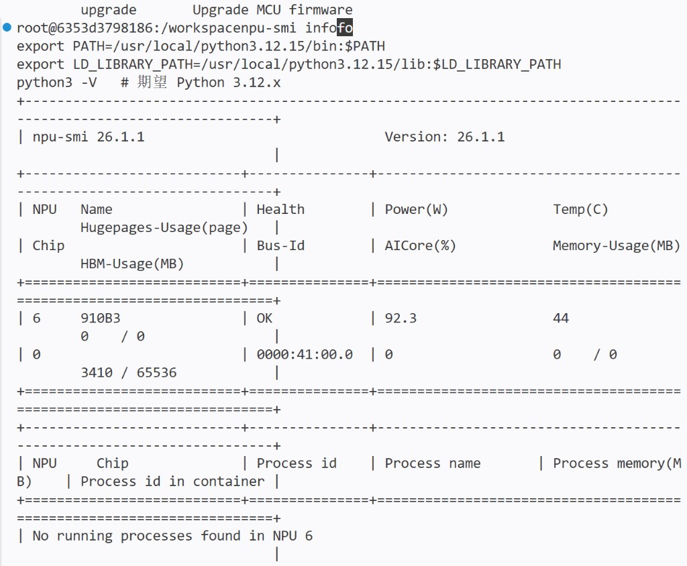
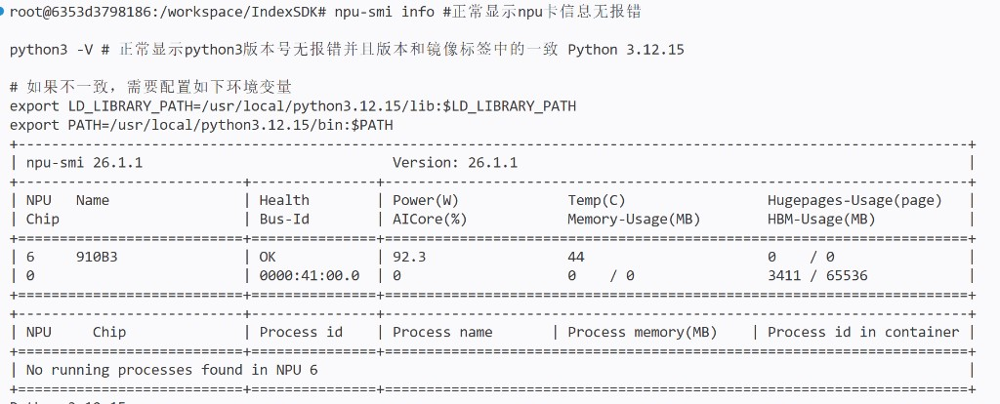
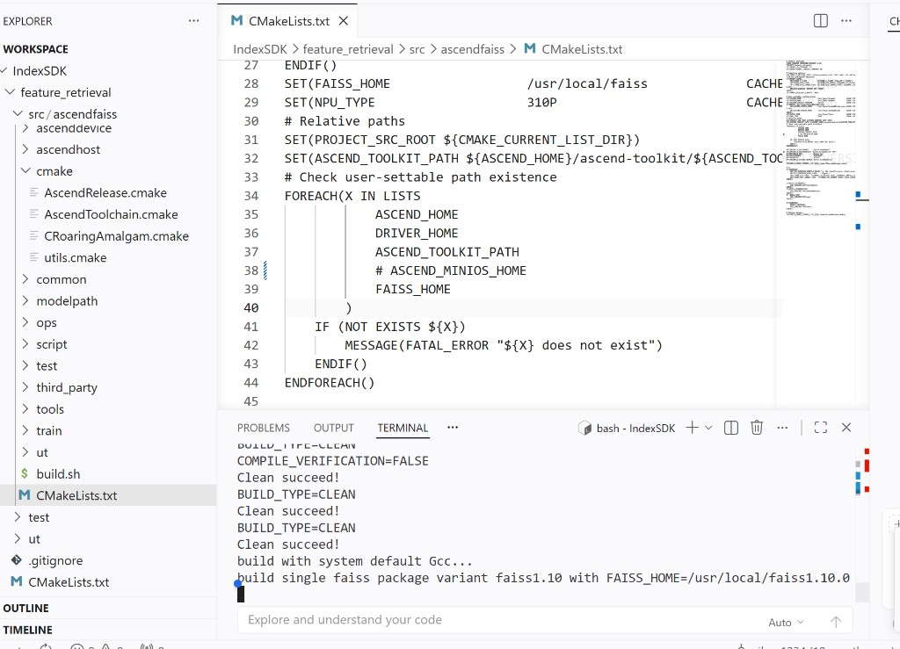
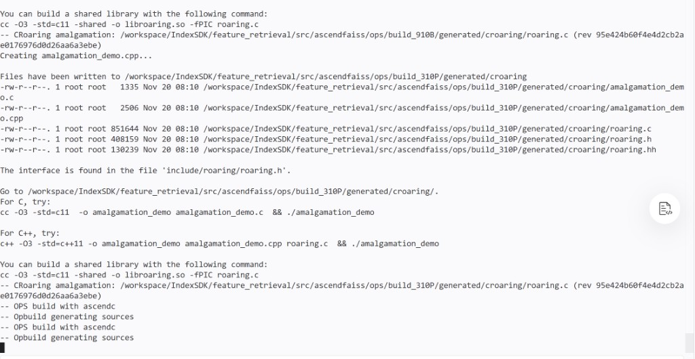
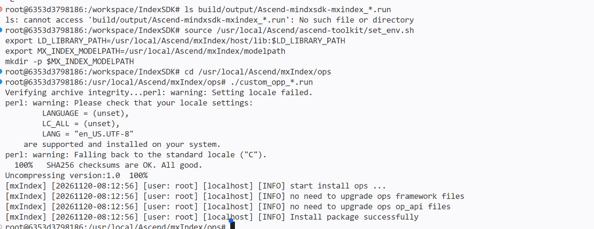
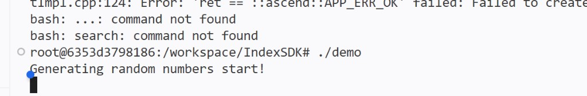
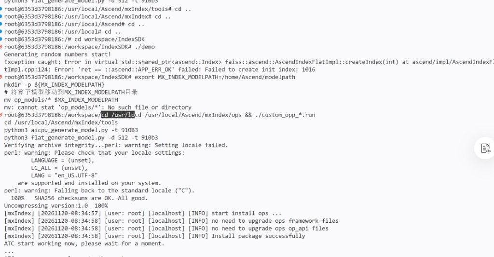

# IndexSDK 910B3 云端快速入门验证报告

> **一句话结论**：未达成。快速入门通过判据是 `./demo` 打印 `search end!`，本次截图没有这条输出。关键阻塞点：有，`AscendIndexFlatImpl.cpp:124` 返回 `Failed to create init index: 1016`（`APP_ERR_ACL_OP_LOAD_MODEL_FAILED`，算子模型加载失败），随后 `mv op_models/*` 报目录不存在。关键指标：NPU 6 / 910B3，Health OK，npu-smi 26.1.1，HBM 3411 / 65536 MB，温度 44℃，功耗 92.3 W，AICore 0%；Python 注释记录为 3.12.15；`custom_opp_*.run` 两次均为 `Install package successfully`；demo 未输出 QPS。

## 1 文档信息

| 项目 | 内容 |
| --- | --- |
| 文档类型 | 验证报告 |
| 提交人 | 李忆南（GitCode ID：sb_qingnian） |
| 文档版本 / 日期 | v1 / 2026-11-20 |
| 验证仓库 | https://gitcode.com/sb_qingnian/IndexSDK |
| 任务入口 | [快速入门](./03_quick_start.md)（仓库内 `docs/zh/03_quick_start.md`） |
| 运行位置 | 容器 `root@6353d3798186`，工作目录 `/workspace/IndexSDK` |
| 材料范围 | 2026-11-20 15:42–16:39 的 7 张终端 / IDE 截图。平台创建页、镜像选择页、`g++` 编译命令、ATC 结束日志、demo 复跑日志不在本次材料中 |

## 2 任务背景与目标

- **任务目标**：在已登录的昇腾容器里，按 Index SDK 快速入门完成环境检查、算子包安装、512 维 Flat 算子模型准备，并跑通 `/workspace/IndexSDK` 下的 `./demo`。官方判据是出现 `search end!`（底库 100 万、维度 512、检索数 128、TopK 10）。
- **任务结果**：未达成。关键阻塞点：有，索引初始化失败，返回码 1016，算子模型文件未就位。关键指标：见文首；环境检查与 `custom_opp_*.run` 安装有成功输出，demo 停在异常栈，截图结束于 `ATC start working, please wait for a moment.`

## 3 环境准备

### 3.1 环境创建步骤

本次材料从容器内终端开始。申请页和镜像选择页没有截图，下面两步只记录材料缺口，不补写未出现的平台名称、实例名或镜像仓库地址。

**步骤 1：申请 / 创建算力环境**

- 操作：材料未包含平台创建页。能确认的只有登录后的容器：主机名 `6353d3798186`，`npu-smi` 可见 1 张卡，NPU 6 / Chip 0 / Name `910B3`，HBM 总量 65536 MB。
- 截图：本次材料未提供 `01_env_create.png`。

**步骤 2：选择镜像**

- 操作：材料未包含镜像选择页，也没有 `docker pull` / `docker run`。终端注释写明 Python 与镜像标签一致，版本为 Python 3.12.15。
- 截图：本次材料未提供 `02_env_image.png`。

**步骤 3：启动并登录开发环境**

- 操作：已在容器内，提示符为 `root@6353d3798186`。15:42 的终端在配置 Python 3.12.15 路径后执行 `npu-smi info`。提示符在该张图里与命令贴在一起，可见文本为 `root@6353d3798186:/workspacenpu-smi info`。
- 截图：

该终端中的原样命令：

```bash
export PATH=/usr/local/python3.12.15/bin:$PATH
export LD_LIBRARY_PATH=/usr/local/python3.12.15/lib:$LD_LIBRARY_PATH
python3 -V # 期望 Python 3.12.x
```

- **预期**：进入容器，`npu-smi info` 能列出 910B 卡。
- **实际**：成功。npu-smi 26.1.1 列出 NPU 6 / 910B3 / Health OK。`python3 -V` 的独立回显行不在这张截图里，版本写在注释「期望 Python 3.12.x」中。

### 3.2 环境信息

16:22 在 `/workspace/IndexSDK` 按快速入门 2.2 再查了一次。原样命令：

```bash
npu-smi info #正常显示npu卡信息无报错

python3 -V # 正常显示python3版本号无报错并且版本和镜像标签中的一致 Python 3.12.15

# 如果不一致，需要配置如下环境变量
export LD_LIBRARY_PATH=/usr/local/python3.12.15/lib:$LD_LIBRARY_PATH
export PATH=/usr/local/python3.12.15/bin:$PATH
```

**截图**：

`npu-smi info` 读数（16:22 这张；15:42 那张仅 HBM 已用量不同，为 3410 / 65536 MB）：

| 项 | 值 |
| --- | --- |
| npu-smi | 26.1.1 |
| NPU / Chip / Name | 6 / 0 / 910B3 |
| Health | OK |
| Power | 92.3 W |
| Temp | 44℃ |
| Bus-Id | 0000:41:00.0 |
| AICore | 0% |
| Memory-Usage | 0 / 0 MB |
| Hugepages-Usage | 0 / 0 page |
| HBM-Usage | 3411 / 65536 MB |
| 进程 | `No running processes found in NPU 6` |

Python 3.12.15 写在 `python3 -V` 同一行的注释里。截图没有单独的 `Python 3.12.15` 回显行。

## 4 实际执行步骤

- **任务入口文档**：https://gitcode.com/sb_qingnian/IndexSDK/blob/master/docs/zh/03_quick_start.md
- **样例 / 代码路径**：运行目录 `/workspace/IndexSDK`，命令 `./demo`。官方样例说明见 `docs/zh/03_quick_start.md` 步骤 4。编译 `demo.cpp` 的 `g++` 命令不在本次截图中。
- **是否修改样例代码**：截图未显示修改 `demo.cpp`。IDE 打开的 `feature_retrieval/src/ascendfaiss/CMakeLists.txt` 可见片段与仓库默认一致：`FAISS_HOME` 为 `/usr/local/faiss`，`NPU_TYPE` 为 `310P`，并检查 `ASCEND_HOME`、`DRIVER_HOME`、`ASCEND_TOOLKIT_PATH`、`FAISS_HOME` 是否存在。

### 步骤 1：清理构建并指定 faiss1.10

截图未露出完整键入命令。16:11 IDE 终端可见日志：

```text
BUILD_TYPE=CLEAN
COMPILE_VERIFICATION=FALSE
Clean succeed!
Clean succeed!
Clean succeed!
build with system default Gcc...
build single faiss package variant faiss1.10 with FAISS_HOME=/usr/local/faiss1.10.0
```

- **预期**：清理完成后进入编译，Faiss 路径可用。
- **实际**：清理成功，日志已切到 faiss1.10，`FAISS_HOME=/usr/local/faiss1.10.0`。这张图没有编译结束标志。
- **截图**：

### 步骤 2：生成 CRoaring 合并源并开始算子构建

截图未露出键入命令。16:12 可见输出：

```text
Files have been written to /workspace/IndexSDK/feature_retrieval/src/ascendfaiss/ops/build_310P/generated/croaring
-- CRoaring amalgamation: .../ops/build_310P/generated/croaring/roaring.c (rev 95e424b60f4e4d2cb2ae0176976d00d26a6a3ebe)
-- OPS build with ascendc
-- Opbuild generating sources
-- Opbuild generating sources
```

同目录还有 `roaring.h`、`amalgamation_demo.c`、`amalgamation_demo.cpp`。界面给出的本地试编译命令（截图中的说明文字，不是已执行记录）：

```bash
cc -O3 -std=c11 -o amalgamation_demo amalgamation_demo.c && ./amalgamation_demo
c++ -O3 -std=c++11 -o amalgamation_demo amalgamation_demo.cpp roaring.c && ./amalgamation_demo
```

- **预期**：算子工程能生成 CRoaring 源并进入 Opbuild。
- **实际**：成功写到 `ops/build_310P/generated/croaring`，Opbuild 已开始生成源。产物目录名是 `build_310P`，与实卡 `910B3` 不一致。这张图没有算子包打包完成的标志。
- **截图**：

### 步骤 3：安装镜像内已有的 mxIndex 算子包

16:14，工作目录 `/workspace/IndexSDK`。原样命令：

```bash
ls build/output/Ascend-mindxsdk-mxindex_*.run
source /usr/local/Ascend/ascend-toolkit/set_env.sh
export LD_LIBRARY_PATH=/usr/local/Ascend/mxIndex/host/lib:$LD_LIBRARY_PATH
export MX_INDEX_MODELPATH=/usr/local/Ascend/mxIndex/modelpath
mkdir -p $MX_INDEX_MODELPATH
cd /usr/local/Ascend/mxIndex/ops
./custom_opp_*.run
```

- **预期**：找到源码构建出的 `.run` 并安装；或安装已有算子包且校验通过。
- **实际**：源码产物不存在，`ls` 输出 `No such file or directory`。随后安装的是镜像内 `/usr/local/Ascend/mxIndex/ops/custom_opp_*.run`。perl 因 `LANGUAGE`、`LC_ALL` 未设置且 `LANG=en_US.UTF-8` 回退到 `C`，该警告后流程继续。`100% SHA256 checksums are OK. All good.`，`Uncompressing version:1.0 100%`。mxIndex 日志：

```text
[mxIndex] start install ops ...
[mxIndex] no need to upgrade ops framework files
[mxIndex] no need to upgrade ops op_api files
[mxIndex] Install package successfully
```

- **截图**：

### 步骤 4：运行 ./demo

16:26 终端上方还有被截断的前一次失败：

```text
...Impl.cpp:124: Error: `ret == ::ascend::APP_ERR_OK` failed: Failed to create
bash: ...: command not found
bash: search: command not found
```

随后原样命令与输出：

```bash
./demo
```

```text
Generating random numbers start!
```

- **预期**：打印 `Generating random numbers start!`，之后出现 `add start!`、`search start!`、`search end!`。
- **实际**：这张图只覆盖到随机数生成开始。`bash: search: command not found` 是 shell 把文本 `search` 当成命令，不是 demo 的检索阶段。
- **截图**：

### 步骤 5：demo 失败后改模型路径并重新生成算子模型

16:39。图顶是一次被截断的 `flat_generate_model.py -d 512 -t 910b3`，接着从 `/usr/local/Ascend/mxIndex/tools` 退回仓库再跑 demo。原样命令：

```bash
cd ..
cd ..
cd ..
cd ..
cd workspace/IndexSDK
./demo
export MX_INDEX_MODELPATH=/home/Ascend/modelpath
mkdir -p $MX_INDEX_MODELPATH
mv op_models/* $MX_INDEX_MODELPATH
cd /usr/local/Ascend/mxIndex/ops && ./custom_opp_*.run
cd /usr/local/Ascend/mxIndex/tools
python3 aicpu_generate_model.py -t 910B3
python3 flat_generate_model.py -d 512 -t 910b3
```

`./demo` 实际输出：

```text
Generating random numbers start!
Exception caught: Error in virtual std::shared_ptr<ascend::Index> faiss::ascend::Index> ascend::impl::AscendIndexFlatImpl::createIndex(int) at ascend/impl/AscendIndexFlatImpl.cpp:124: Error: `ret == ::ascend::APP_ERR_OK` failed: Failed to create init index: 1016
```

`mv` 实际输出：

```text
mv: cannot stat 'op_models/*': No such file or directory
```

第二次 `./custom_opp_*.run` 再次出现 locale 回退到 `C` 的警告，随后：

```text
100% SHA256 checksums are OK. All good.
Uncompressing version:1.0 100%
[mxIndex] start install ops ...
[mxIndex] no need to upgrade ops framework files
[mxIndex] no need to upgrade ops op_api files
[mxIndex] Install package successfully
ATC start working, please wait for a moment.
```

- **预期**：模型文件进入 `MX_INDEX_MODELPATH`，ATC 结束，再次 `./demo` 打印 `search end!`。
- **实际**：失败后进入补救。返回码 1016 对应文档中的 `APP_ERR_ACL_OP_LOAD_MODEL_FAILED`。`op_models` 不存在，模型没有移动成功。算子包重复安装成功。ATC 已启动，截图在 `please wait for a moment.` 处截断，没有 ATC 完成日志，也没有第二次 `./demo`。两条生成命令的芯片参数大小写不同：`-t 910B3` 与 `-t 910b3`。
- **截图**：

## 5 执行结果

- **结论**：不通过
- **判据**：快速入门规定 `./demo` 出现 `search end!` 才算运行成功。本次材料中的 demo 在 `Generating random numbers start!` 之后抛出异常并返回，没有 `add start!`、`search start!`、`search end!`，也没有 QPS 行。

关键输出：

```text
Generating random numbers start!
Exception caught: Error in virtual std::shared_ptr<ascend::Index> faiss::ascend::Index> ascend::impl::AscendIndexFlatImpl::createIndex(int) at ascend/impl/AscendIndexFlatImpl.cpp:124: Error: `ret == ::ascend::APP_ERR_OK` failed: Failed to create init index: 1016
```

已通过的检查：

| 检查 | 结果 |
| --- | --- |
| `npu-smi info` | 通过。910B3，Health OK，无业务进程 |
| Python 路径 | 注释记录为 3.12.15，与镜像标签一致；无独立回显行 |
| `custom_opp_*.run` | 通过两次。SHA256 通过，`Install package successfully`；框架与 op_api 均为 `no need to upgrade` |
| CRoaring / Opbuild | 源文件已写入 `ops/build_310P/generated/croaring`，Opbuild 已开始 |
| `./demo` | 不通过。返回码 1016 |
| 512 维 Flat 模型 | 未完成。`op_models` 不存在；ATC 仅显示开始 |

## 6 发现的问题

本次只形成记录，没有在 GitCode 创建 issue。

| 问题 | 提交 issue |
| --- | --- |
| 在 `/workspace/IndexSDK` 执行 `./demo`，随机数生成开始后于 `AscendIndexFlatImpl::createIndex` 失败，返回码 1016（算子模型加载失败） | 未提交 |
| 按快速入门执行 `mv op_models/* $MX_INDEX_MODELPATH` 时，当前目录没有 `op_models`，模型未放入 `/home/Ascend/modelpath`。此前还把 `MX_INDEX_MODELPATH` 设为 `/usr/local/Ascend/mxIndex/modelpath`，两处路径不一致 | 未提交 |
| `ls build/output/Ascend-mindxsdk-mxindex_*.run` 找不到源码构建包，实际安装的是镜像内 `/usr/local/Ascend/mxIndex/ops/custom_opp_*.run`，且提示无需升级 | 未提交 |
| 实卡 Name 为 `910B3`，算子构建产物目录为 `ops/build_310P`；模型命令又分别使用 `-t 910B3` 和 `-t 910b3` | 未提交 |
| `custom_opp_*.run` 安装时 perl 报 `LANGUAGE`、`LC_ALL` 未设置，回退到 locale `C`。SHA256 与安装结果不受影响 | 未提交 |

覆盖范围：上述问题都来自这 7 张截图。未覆盖驱动安装、镜像拉取、`demo.cpp` 编译、ATC 结束状态，以及 1016 修复后的复测。

## 7 总结

1. 环境检查通过：NPU 6、芯片 910B3、Health OK、npu-smi 26.1.1、HBM 3411/65536 MB、温度 44℃、功耗 92.3 W，卡上无业务进程。
2. 镜像内算子包安装通过：`custom_opp_*.run` 两次 SHA256 校验通过并打印 `Install package successfully`；仓库 `build/output` 下没有对应 `.run`。
3. 快速入门样例未通过：`./demo` 返回 1016，没有 `search end!`，没有 QPS。直接原因是算子模型未加载，`op_models` 目录不存在。
4. 补救停在模型生成中途：已再次安装算子包并执行 `aicpu_generate_model.py -t 910B3` 与 `flat_generate_model.py -d 512 -t 910b3`，最后一条可见日志是 `ATC start working, please wait for a moment.`
5. 要判定本次任务通过，还需要 ATC 完成、模型文件进入实际生效的 `MX_INDEX_MODELPATH`，以及同目录下再次 `./demo` 并保留含 `search end!` 的日志。
