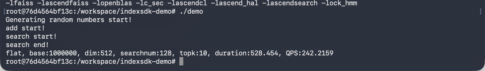
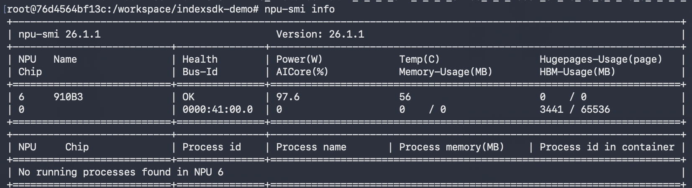
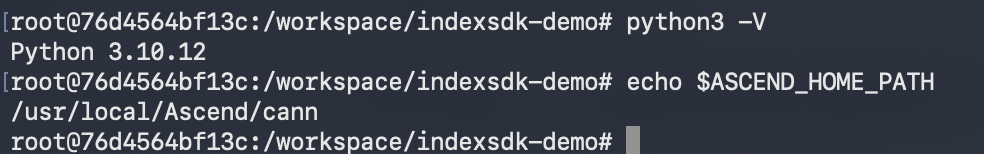
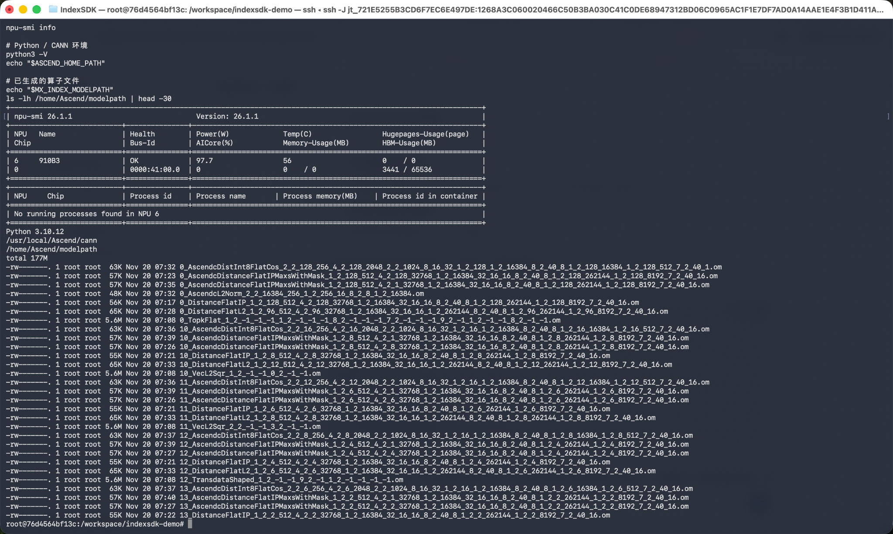
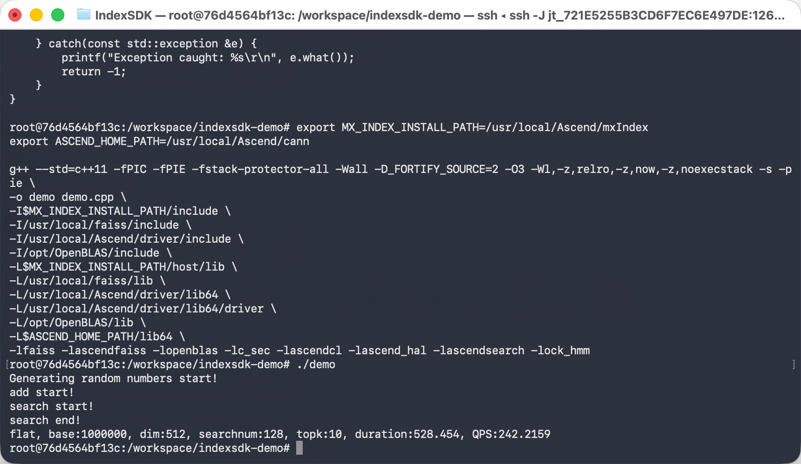

# 【MindSDK】基于IndexSDK完成检索算法验证任务 总结报告

> **一句话结论**：**已达成核心检索验证目标**：在昇腾 Ascend 910B3 环境中使用 IndexSDK Flat（Inner Product）索引，完成 **100 万条、512 维底库 / 128 条查询 / TopK 10** 的 C++ 检索测试；单次查询批次耗时 **528.454 ms**，对应 **242.2159 QPS**。过程中曾出现 ATC 编译进程被 `Killed`，后续已成功运行样例；异常的系统级根因未获证实。

## 1 文档信息

| 项目 | 内容 |
| --- | --- |
| 文档类型 | 验证报告 / 实操体验总结 |
| 任务名称 | 【MindSDK】基于IndexSDK完成检索算法验证任务 |
| 提交人 | GitCode ID：**【请填写】** |
| 文档版本 / 日期 | v1.0 / 2026-11-20 |
| 实际运行实例 | **DevEnv_010997** |
| 执行位置 | 华为在线开发环境中的容器，`root@76d4564bf13c` |
| 提交位置 | `Ascend/IndexSDK` 的 `experimental` 分支、`experimental/` 目录 |

## 2 任务背景与目标

- **任务目标**：根据 [IndexSDK《快速入门》](https://gitcode.com/Ascend/IndexSDK/blob/master/docs/zh/03_quick_start.md)，验证 NPU 环境、Flat 算子模型和 C++ 检索样例的可用性，完成百万级向量库检索，记录结果并反馈实际使用问题。
- **验收目标**：能编译并运行 C++ 示例，输出成功的 `search end!`、检索规模与耗时、QPS。
- **任务结果**：上述**功能验证已通过**；过程中 Flat 算子生成曾因 ATC 子进程退出而中断，但最终用于检索的模型和运行环境已可用。
- **备注**：此次仅验证 Flat / Inner Product 官方样例，未进行准确率对照测试、多轮预热压测或算法间性能比较。

## 3 环境准备

### 3.1 环境创建步骤

**步骤 1：申请 / 创建算力环境**

- **操作**：在在线开发平台使用昇腾 **A2** 算力资源，创建并启动开发环境；**本次实际使用的实例名称为 `DevEnv_010997`**。
- **硬件**：容器内实际识别到 1 张可用 **Ascend 910B3**，HBM 总容量 **65536 MB**；具体计算规格和磁盘规格未留存完整的实例详情，不做推断。
- **截图**：实例列表中可见 `DevEnv_010997` 运行中。


**步骤 2：选择镜像**

- **操作**：使用平台的 **【应用使能】IndexSDK** 推荐镜像；所提供的镜像选择界面显示版本 **26.2.0**、Ubuntu 22.04、Python 3.12。
- **证据说明**：此图来自**镜像选择界面参考截图**，图上填写的 `DevEnv_490846` 并非本次实操实例，**本次运行实例始终以 `DevEnv_010997` 为准**。截图用来说明镜像名称及选择方式，不用来证明 `DevEnv_010997` 的历史创建表单。


**步骤 3：启动并登录开发环境**

- **操作**：连接到容器终端后进入 `/workspace/indexsdk-demo`，执行 C++ 编译和检索测试。
- **实际终端提示符**：`root@76d4564bf13c:/workspace/indexsdk-demo#`。
- **截图说明**：从实际运行成功的终端截图截取工作目录与 shell 提示符作为登录环境证据，并非初次连接瞬间的截图。



### 3.2 环境信息

执行过的环境检查命令包含：

```bash
export PATH=/usr/local/python3.12.15/bin:$PATH
python3 -V
source /usr/local/Ascend/ascend-toolkit/set_env.sh
echo $ASCEND_HOME_PATH
npu-smi info
```

| 检查项 | 实际记录 |
| --- | --- |
| NPU 型号 | **Ascend 910B3** |
| NPU 健康状态 | **OK** |
| NPU HBM 总量 | **65536 MB** |
| `npu-smi` 版本 | **26.1.1** |
| 最初配置后的 Python | **Python 3.12.15** |
| 最初加载 toolkit 后的 CANN 路径 | `/usr/local/Ascend/cann-9.2.0` |
| 后续终端会话中的 Python | **Python 3.10.12**（截图原样保留） |
| 后续编译会话中的 `ASCEND_HOME_PATH` | `/usr/local/Ascend/cann` |
| 平台镜像选择界面显示 | IndexSDK 26.2.0（镜像界面信息；未通过运行时版本命令独立复核） |

> **环境差异说明**：上述 Python/CANN 路径来自**不同时间的终端会话**。早期通过调整 `PATH` 得到 Python 3.12.15；后续补拍环境截图时显示 Python 3.10.12。此处不把截图改写成 3.12.15，也不据此断言实际 C++ 检索所依赖的 Python 版本。后续编译和运行则使用 `/usr/local/Ascend/cann`，以已成功执行的原始命令为准。





## 4 实际执行步骤

- **任务入口文档**：[IndexSDK 快速入门](https://gitcode.com/Ascend/IndexSDK/blob/master/docs/zh/03_quick_start.md)
- **样例 / 代码路径**：官方文档“步骤 4：用例测试”的 `demo.cpp`，容器内存放于 `/workspace/indexsdk-demo/demo.cpp`。
- **是否修改样例代码**：根据所展示的样例参数与最终日志，**未发现需依赖修改核心算法参数才能运行的情况**；未留存逐行差异比对，不能独立证明源文件与官网完全一致。
- **命令记录原则**：下文将已留存的原始命令写为执行记录；缺失的完整历史命令只描述实际操作，不以参考命令冒充运行记录。

### 步骤 1：检查环境并确认 NPU

```bash
export PATH=/usr/local/python3.12.15/bin:$PATH
python3 -V
source /usr/local/Ascend/ascend-toolkit/set_env.sh
echo $ASCEND_HOME_PATH
npu-smi info
```

- **预期**：Python 与 CANN 环境可用，NPU 正常。
- **实际**：初始记录中 Python 3.12.15，CANN 指向 `/usr/local/Ascend/cann-9.2.0`；`npu-smi info` 返回 `910B3`、`Health OK`。
- **截图**：第 3.2 节中的 `04_npu_smi.png` 和 `05_env_versions.png`（后者对应不同终端会话，已注明差异）。

### 步骤 2：准备 512 维 Flat 算子模型

- **操作**：按官方快速入门执行算子相关准备与 512 维 Flat 模型生成。过程中曾出现 `atc.bin` 进程 `Killed`，导致该次生成任务失败。
- **关键错误日志（实操时保留的文本）**：

```text
start compile Ascend C operator DistanceFlatL2. kernel name is distance_flat_l2
start compile Ascend C operator DistanceFlatIP. kernel name is distance_flat_ip
/usr/local/Ascend/ascend-toolkit/latest/bin/atc: line 22: 45106 Killed ${PKG_PATH}/bin/atc.bin "$@"
[ERROR] TBE Subprocess[task_distribute] raised error[], main process disappeared!
/usr/local/python3.12.15/lib/python3.12/multiprocessing/resource_tracker.py:279: UserWarning: resource_tracker: There appear to be 30 leaked semaphore objects to clean up at shutdown
RuntimeError: Failed to generate op models.
```

- **预期**：生成可供检索调用的 `.om` 算子模型。
- **实际**：首次相关生成尝试出现异常；后续环境中已可查看 `/home/Ascend/modelpath` 下的 `.om` 文件，并成功运行依赖这些资源的检索测试。
- **问题判断**：该日志证明子进程被系统终止，但**未留存 OOM 事件计数，因此不能确认其根因就是内存不足**。具体异常建议单独反馈 Issue。
- **执行记录完整性**：该步骤未保留所有命令及成功重试的完整终端日志，因此此处不将任何推荐的重试参数写为已执行的完整事实。

模型目录及文件检查的留存命令：

```bash
echo "$MX_INDEX_MODELPATH"
ls -lh /home/Ascend/modelpath | head -30
```

截图显示模型路径 `/home/Ascend/modelpath`，目录显示 `total 177M`，可见 `.om` 文件列表。



### 步骤 3：编译 C++ 检索示例

- **工作目录**：`/workspace/indexsdk-demo`。
- **实际设置的安装路径**：

```bash
export MX_INDEX_INSTALL_PATH=/usr/local/Ascend/mxIndex
export ASCEND_HOME_PATH=/usr/local/Ascend/cann
```

实际编译命令：

```bash
g++ --std=c++11 -fPIC -fPIE -fstack-protector-all -Wall -D_FORTIFY_SOURCE=2 -O3 -Wl,-z,relro,-z,now,-z,noexecstack -s -pie \
-o demo demo.cpp \
-I$MX_INDEX_INSTALL_PATH/include \
-I/usr/local/faiss/include \
-I/usr/local/Ascend/driver/include \
-I/opt/OpenBLAS/include \
-L$MX_INDEX_INSTALL_PATH/host/lib \
-L/usr/local/faiss/lib \
-L/usr/local/Ascend/driver/lib64 \
-L/usr/local/Ascend/driver/lib64/driver \
-L/opt/OpenBLAS/lib \
-L$ASCEND_HOME_PATH/lib64 \
-lfaiss -lascendfaiss -lopenblas -lc_sec -lascendcl -lascend_hal -lascendsearch -lock_hmm
```

- **预期**：无编译错误、生成可执行文件 `demo`。
- **实际**：成功编译，并在同一终端运行 `./demo`。
- **截图**：`07_demo_compile_run.png`，同时包含编译命令与运行结果。



### 步骤 4：运行百万级 Flat 检索测试

```bash
./demo
```

- **预期**：底库添加、检索调用完成，输出 `search end!` 及完整性能信息。
- **实际**：成功，详见第 5 节的终端原始输出。
- **截图**：沿用 `07_demo_compile_run.png`，其下方即为本次真实结果（避免重复上传相同截图）。

## 5 执行结果

- **结论**：**通过（Flat 官方样例功能验证）**。
- **判据**：程序输出 `search end!`，完整打印检索参数和耗时/QPS，并返回 shell 提示符；本次日志无 C++ 运行异常栈。

关键输出（原始日志）：

```text
root@76d4564bf13c:/workspace/indexsdk-demo# ./demo
Generating random numbers start!
add start!
search start!
search end!
flat, base:1000000, dim:512, searchnum:128, topk:10, duration:528.454, QPS:242.2159
root@76d4564bf13c:/workspace/indexsdk-demo#
```

| 指标 | 结果 |
| --- | ---: |
| NPU | Ascend 910B3 |
| 检索算法 | Flat / Inner Product |
| 底库向量数 | 1,000,000 |
| 向量维度 | 512 |
| 单次查询向量数 | 128 |
| TopK | 10 |
| 查询批次耗时 | **528.454 ms** |
| QPS | **242.2159 查询向量/秒** |
| 性能统计口径 | 官方样例 `loopTimes=1`，`128 × 1000 / 528.454` |

> 本次仅为**一次批次检索的观察值**。程序的随机数生成、数据归一化、构建/添加底库等时间不包含在 `duration` 测量区间内；不能据此宣称经过充分预热的稳定 QPS 或端到端吞吐量。

## 6 发现的问题

| 问题 | 提交 Issue |
| --- | --- |
| 生成 512 维 Flat 算子时，ATC 子进程异常终止（`Killed`），最终返回 `Failed to generate op models`；快速入门对资源限制、并发调节和异常后的完整性验证说明不足 | **【提交 Issue 后填写真实链接或编号】** |

**现状**：从 `Killed` 和上层异常无法直接分辨是容器内存限制、宿主机资源问题或其他外部终止原因，给首次使用者排查带来困难。

**优化建议**：在快速入门“步骤 3：算子生成”补充预估的 CPU 内存/磁盘需求、可用的并发控制参数（如版本支持 `-pool` 时如何使用）、容器 cgroup OOM 排查命令、失败后重试方式，以及“如何确认全部算子模型生成成功”的验收检查。

**问题界限**：本次没有内存/OOM 事件证据，不将 OOM 写为已确认原因。正式提交前应先查重同类 Issue。

## 7 总结

1. **功能验证完成**：Ascend 910B3 成功运行 IndexSDK Flat（内积）官方 C++ 示例，底库为 **100 万 × 512 维**，单批查询数 **128**，`TopK=10`。
2. **可复核的性能结果**：此次运行测得批次检索耗时 **528.454 ms**、**242.2159 QPS**，指标和口径均保留在终端原始截图中。
3. **体验问题可定位**：算子生成时存在 ATC 子进程被 `Killed`、上层提示不够直观的问题，建议通过独立 Issue 反馈文档资源与异常排查信息不足。

## 8 体验总结

| 维度 | 评价 | 说明 |
| --- | --- | --- |
| 文档易懂度 | 一般 | 快速入门提供了明确的 Flat 示例；但对预装镜像中的依赖判断和不同 Python/CANN 路径切换可增加说明。 |
| 流程顺畅度 | 一般 | 环境检查与 C++ 示例执行顺利；算子生成异常需要额外排查，影响连续性。 |
| 报错可读性 | 一般 | `Killed` 和 `Failed to generate op models` 能说明有任务失败，但无法直接判断系统终止原因及是否可安全继续。 |
| 整体评价 | **3.5 / 5（建议评价，可由提交者调整）** | 最终功能验证成功，故障处理指引还有改进空间。 |

- **最耗时的一步**：算子模型生成与异常排查；**未记录准确耗时**，不填写估算分钟数。
- **最值得改进的点**：为 ATC 生成阶段增加并发/CPU 内存建议、`Killed` 排查手册和模型完整性核验方法。

---

### 提交前需补的文字字段（不需再截图）

- GitCode ID：`【请填写】`
- 已创建 Issue 的链接：`【提交后回填】`
- 体验评分（如与本人感受不同，可修改 `3.5 / 5`）

> **截图范围声明**：本报告仅使用已留存的实际实例列表、镜像选择界面、终端、NPU、版本、模型目录、编译和运行截图。历史 ATC 报错未保留截图，以当时复制的原始日志作为证据；未伪造成功生成的终端输出或不存在的步骤截图。
