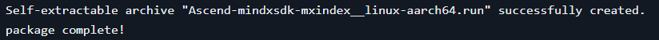
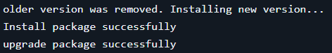
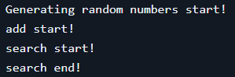
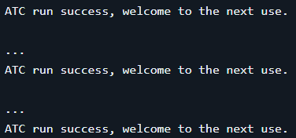
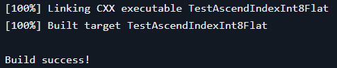
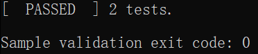

# 【MindSDK】基于 IndexSDK 完成检索算法验证任务 总结报告

我在昇腾 A2 单卡环境中完成了 IndexSDK 源码构建与重装，随后跑通 Flat 快速入门程序以及 Int8Flat 的吞吐和准确性用例。源码包的版本字段缺失，Int8Flat 样例文件头的生成命令与用户指南不一致，两项问题均已单独记录。

## 1 文档信息

| 项目 | 内容 |
| --- | --- |
| 文档类型 | MeetUp 检索算法验证体验报告（公开版） |
| 提交人 | GitCode ID：dsdjafk |
| 版本与日期 | v1，2026-11-20 |
| 验证的源码 | Ascend/IndexSDK，提交 `99c64b7d04f29f6a056e7c795424f64236b8e389`。[仓库快照](https://gitcode.com/Ascend/IndexSDK/tree/99c64b7d04f29f6a056e7c795424f64236b8e389) |

## 2 任务背景与目标

验证开发者能否依据社区文档，从源码构建不含 ILFlat 的安装包，在 NPU 环境中完成重装，生成相应检索模型，最后分别编译并运行 Flat 和 Int8Flat 样例。两个样例均使用该提交中的公开代码，未修改检索逻辑。

## 3 环境准备

本次使用昇腾 A2 单卡 Linux 容器。登录后先用 `npu-smi info` 确认可用设备，再核对 Python、CANN、Faiss 和编译依赖。复查时，模型生成命令中的 `NPU_MODEL` 应填写本机芯片型号，`MX_INDEX_MODELPATH` 应指向当前运行进程可访问的模型目录。依赖与环境变量按仓库文档设置。[安装与环境准备](https://gitcode.com/Ascend/IndexSDK/blob/99c64b7d04f29f6a056e7c795424f64236b8e389/docs/zh/04_installation_guide.md)

## 4 实际执行步骤

以下命令是依据公开仓库整理的复查入口。各步骤所附图片均为本次已留存截图的矩形裁切，仅保留相应的结果行。前五张取自终端记录的只读视图，最后一张取自现场结果回读的原生终端窗口。完整会话、原始日志和原图在本地留存。

1. **构建并重装 SDK。** 按源码安装说明将 `BUILD_ASCENDDEVICE` 设为 `OFF`，并调整该模式下的 `ASCEND_MINIOS_HOME` 依赖检查。随后在仓库根目录运行构建脚本，对本次生成的安装包执行自校验，并用其升级安装到 910B 平台。完成后检查安装目录、动态库和版本文件，再安装随包提供的自定义算子。[源码安装指南](https://gitcode.com/Ascend/IndexSDK/blob/99c64b7d04f29f6a056e7c795424f64236b8e389/docs/zh/04_installation_guide.md)

   ```bash
   bash build/build.sh
   # RUN_PACKAGE 指向 build/output 下刚生成的 aarch64 安装包
   bash "$RUN_PACKAGE" --check
   bash "$RUN_PACKAGE" --upgrade --quiet --install-path=/usr/local/Ascend --platform=910B
   ```

   

   

2. **生成模型并运行 Flat。** 在 SDK 的 `tools` 目录依次生成公共 AICPU 模型和 Flat 模型，将产物复制到 `MX_INDEX_MODELPATH`。按快速入门给出的 C++ 代码与编译命令生成 `demo`，再在编译目录执行 `./demo`。验证时同时检查检索完成标志和性能统计行。[Flat 快速入门](https://gitcode.com/Ascend/IndexSDK/blob/99c64b7d04f29f6a056e7c795424f64236b8e389/docs/zh/03_quick_start.md)

   ```bash
   python3 aicpu_generate_model.py -t "$NPU_MODEL"
   python3 flat_generate_model.py -d 512 -t "$NPU_MODEL"
   ```

   

3. **按样例参数生成 Int8Flat 模型。** 官方样例使用 256 维向量，构造索引时沿用默认分块。结合配置 API，在独立模型生成目录运行下列命令，随后把生成的 `.om` 文件复制到本次使用的模型目录。显式指定 `-code 262144` 可只生成符合该样例分块大小的模型。[Int8Flat 用户指南](https://gitcode.com/Ascend/IndexSDK/blob/99c64b7d04f29f6a056e7c795424f64236b8e389/docs/zh/05_user_guide.md#L287) · [分块配置 API](https://gitcode.com/Ascend/IndexSDK/blob/99c64b7d04f29f6a056e7c795424f64236b8e389/docs/zh/api/01_full_retrieval/07_AscendIndexInt8FlatConfig.md)

   ```bash
   python3 /usr/local/Ascend/mxIndex/tools/int8flat_generate_model.py -d 256 -t "$NPU_MODEL" -code 262144
   ```

   

4. **编译并运行 Int8Flat。** 在源码仓库的 `examples/` 目录按名称构建样例，在 `build/` 目录执行。分别核对吞吐用例的各批量输出、准确性用例对 CPU 参照结果的比较，以及 GoogleTest 对两个用例的通过记录。[样例构建说明](https://gitcode.com/Ascend/IndexSDK/blob/99c64b7d04f29f6a056e7c795424f64236b8e389/examples/README.md) · [Int8Flat 样例源码](https://gitcode.com/Ascend/IndexSDK/blob/99c64b7d04f29f6a056e7c795424f64236b8e389/examples/TestAscendIndexInt8Flat.cpp)

   ```bash
   bash build.sh TestAscendIndexInt8Flat
   cd build
   ./TestAscendIndexInt8Flat
   ```

   

   

## 5 执行结果

| 验证项 | 实机结论及判据 |
| --- | --- |
| 构建和重装 | 通过。生成的运行包通过自校验，安装器完成升级，新的动态库可被样例加载。包内版本字段存在第 6 节所述问题。 |
| Flat | 通过。程序完成建库与查询，并输出检索完成标志和符合样例参数的性能统计行。 |
| Int8Flat | 通过。QPS 用例输出各档查询批量的吞吐结果，Acc 用例输出与 CPU 参照结果比较的召回指标。两个用例均完成并通过。 |

## 6 发现的问题

| 问题 | 证据与影响 | 社区记录 |
| --- | --- | --- |
| 独立克隆构建后的包名和版本字段为空 | 打包脚本从仓库外读取版本配置。该来源缺失时仍会生成包，影响安装后的版本追踪。[打包脚本](https://gitcode.com/Ascend/IndexSDK/blob/99c64b7d04f29f6a056e7c795424f64236b8e389/build/package.sh#L20) | [版本追踪问题 #216](https://gitcode.com/Ascend/IndexSDK/issues/216) |
| Int8Flat 样例文件头给出了 Flat 模型脚本名 | 样例第 20 行写作 `flat_generate_model.py`，用户指南给出的 Int8Flat 专用脚本为 `int8flat_generate_model.py`。本次跑通了专用脚本路径，未对照运行注释中的错误路径。[样例注释](https://gitcode.com/Ascend/IndexSDK/blob/99c64b7d04f29f6a056e7c795424f64236b8e389/examples/TestAscendIndexInt8Flat.cpp#L20) · [用户指南](https://gitcode.com/Ascend/IndexSDK/blob/99c64b7d04f29f6a056e7c795424f64236b8e389/docs/zh/05_user_guide.md#L287) | [样例注释问题 #217](https://gitcode.com/Ascend/IndexSDK/issues/217) |

## 7 总结

从社区源码构建的 SDK 能够完成两种指定的 NPU 检索验证。复查 Flat 时可以直接跟随快速入门。复查 Int8Flat 时应先从样例和配置 API 确认维度、芯片型号和分块大小，再按专用脚本生成模型。安装包的版本元数据需要单独检查。

## 8 体验总结

| 维度 | 评价 | 依据 |
| --- | --- | --- |
| 文档易懂度 | 一般 | Flat 的操作顺序清楚。Int8Flat 的脚本和分块参数要在样例、用户指南和配置 API 之间核对。 |
| 流程顺畅度 | 一般 | 构建和重装能按指南完成。最耗时的是 Int8Flat 模型准备，限定生成范围可以减少额外编译。 |
| 报错可读性 | 一般 | 打包阶段能看到版本来源缺失，但脚本继续执行，直到检查包名和版本文件时才容易判断影响。 |
| 整体评价 | 3 / 5 | 两个样例均可复验。优先改进独立构建的版本来源，并在样例入口说明 Int8Flat 的专用生成命令。 |
