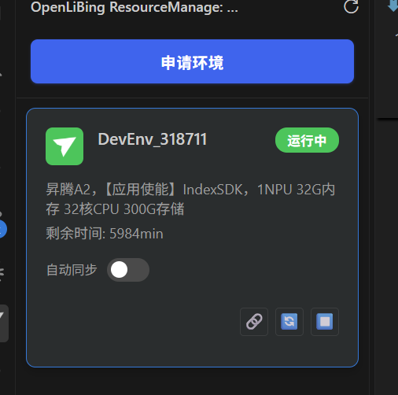
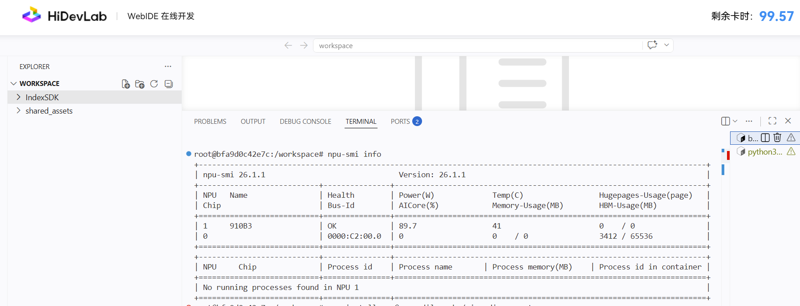
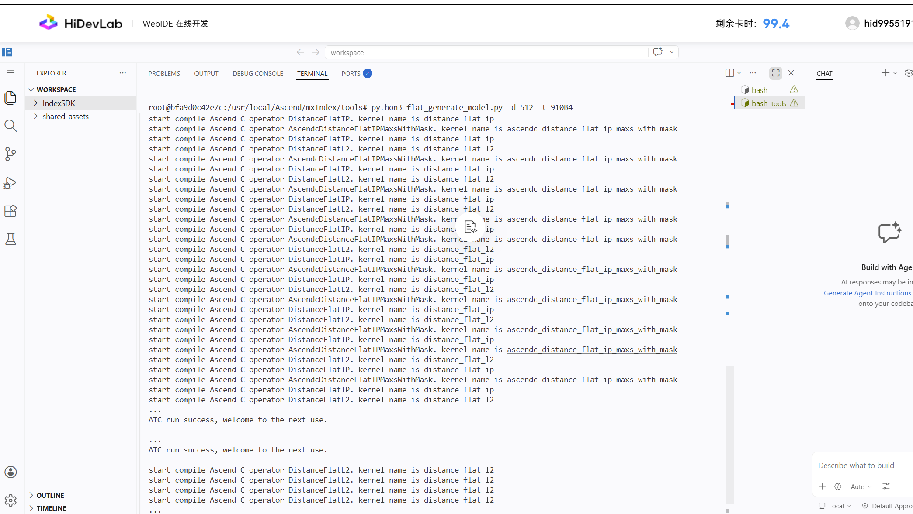
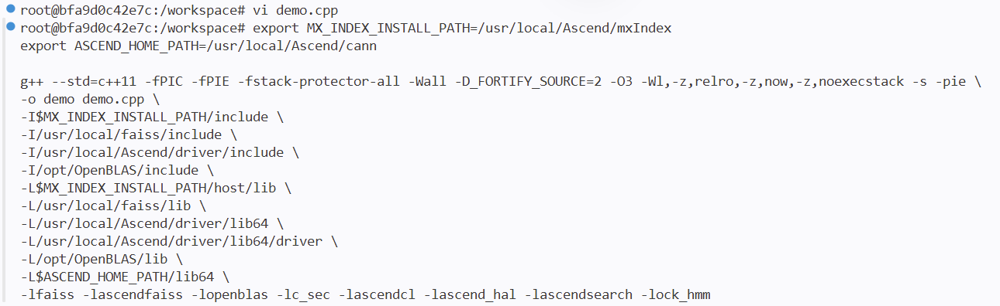
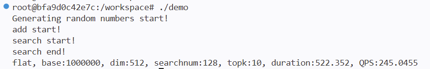
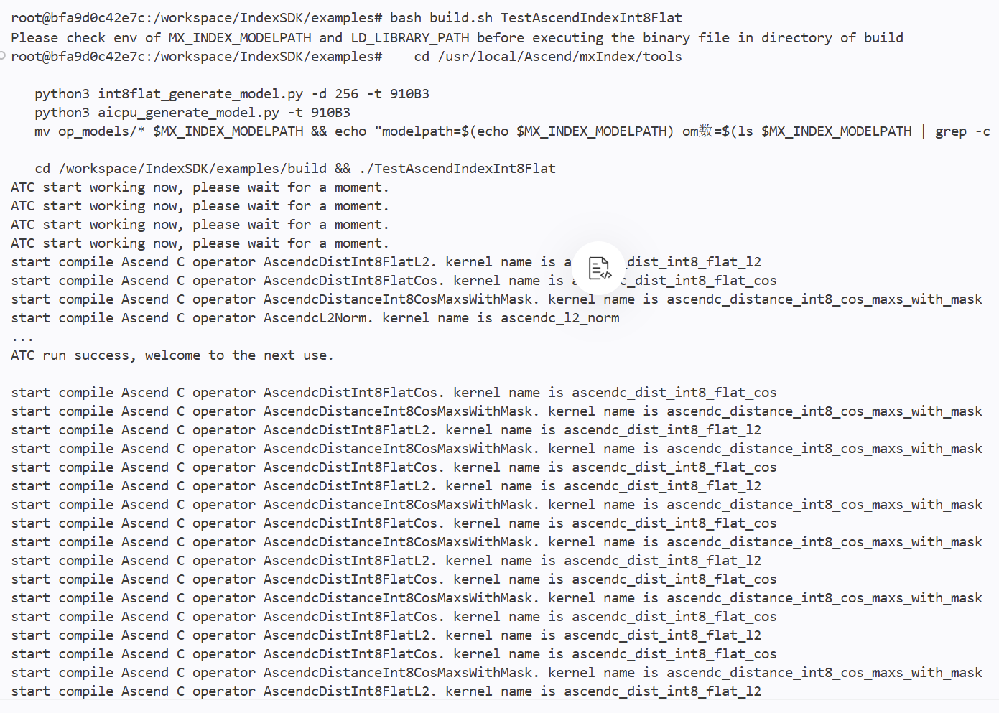
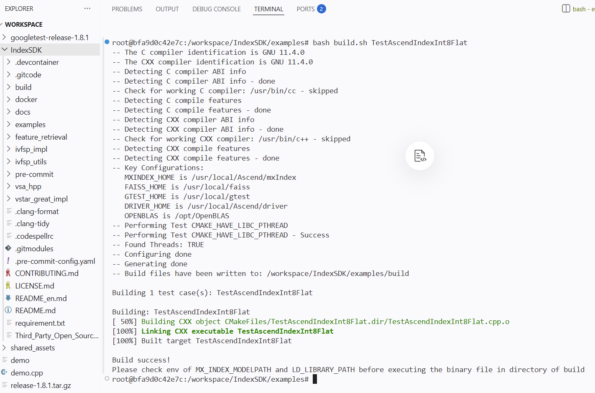
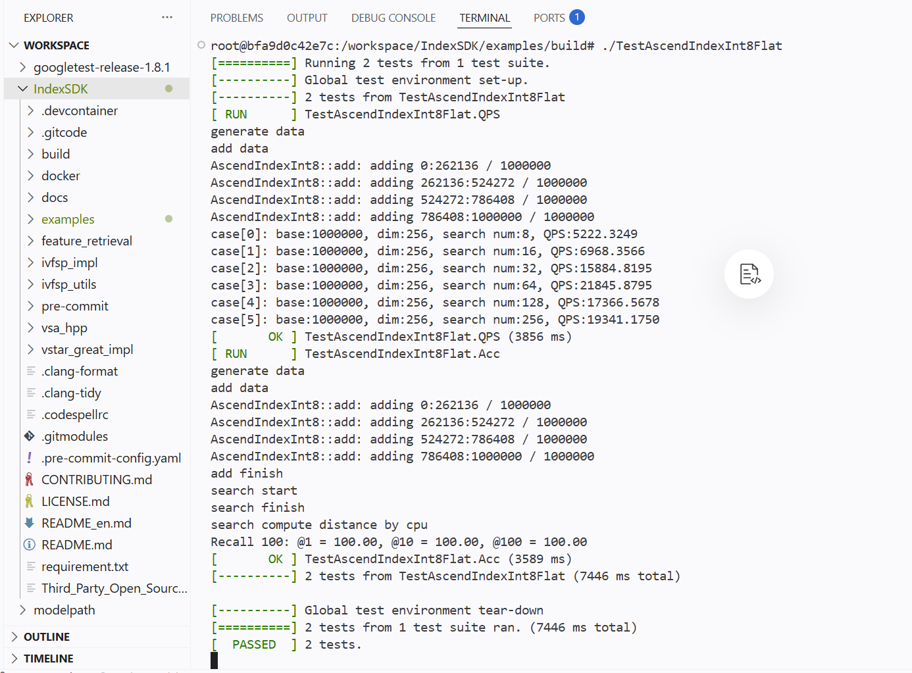

# 【MeetUp】基于 IndexSDK 完成检索算法验证 总结报告

> **一句话结论**：目标达成——在昇腾 A2（910B3，1 卡）上按快速入门跑通 Flat 全量检索（100 万 × 512 维，QPS 245.05）与 Int8Flat 检索（100 万 × 256 维，最高 QPS 21845.88，Recall@1/10/100 均 100.00%）；环境开箱即用、样例齐全，全流程无阻塞，性能与精度均达预期。

## 1 文档信息

| 项目 | 内容 |
| --- | --- |
| 文档类型 | 验证报告 |
| 提交人 | GitCode ID：gcw_0PpS4Ib5 |
| 文档版本 / 日期 | v1 / 2026-11-20 |

## 2 任务背景与目标

- **任务目标**：在 NPU（昇腾 A2，1 卡）容器环境中，按 IndexSDK 官方文档完成两件事并输出验证报告——① 生成 Flat 算子、编译用例并跑通 Flat 检索；② 生成 Int8Flat 算子并跑通 `examples/TestAscendIndexInt8Flat.cpp`。
- **任务结果**：两项均达成，附完整日志截图。
- **环境说明**：IndexSDK 26.2.0 镜像已预装 run 包（`/usr/local/Ascend/mxIndex`）与算子包（`mxIndex/ops/custom_opp_aarch64.run`），并已内置 gtest 与 `MX_INDEX_MODELPATH`；本次验证直接使用镜像内组件，无需源码构建 run 包。
- **关键指标**：Flat 245.0455 QPS（base 100 万 / dim 512 / nq 128 / topk 10）；Int8Flat 最高 21845.8795 QPS（base 100 万 / dim 256 / search num 64 / topk 128），Recall@1=@10=@100=100.00%。

## 3 环境准备

### 3.1 环境创建步骤

**步骤 1：申请 / 创建算力环境**

- 操作：HiDevLab → 在线开发 → 开发环境 → 创建环境 `创建环境1`；配置规格选 **1 NPU · 算子调试/小模型训推**（每小时约消耗 1 卡时）；挂载目录 `/workspace`；实例 `DevEnv_318711`，创建时间 2026-11-20 14:29:52。
- 实例规格：昇腾A2，**1 NPU / 32G 内存 / 32 核 CPU / 300G 存储**。

**步骤 2：选择镜像**

- 操作：推荐镜像 → 搜索「IndexSDK」→ 选择 **【应用使能】IndexSDK 26.2.0**（组件镜像）。
- 截图（同时可见镜像类型与「1 NPU」规格选择）：

**步骤 3：启动并登录开发环境**

- 操作：实例状态「运行中」后，点击「连接」进入 WebIDE 在线开发。登录成功后即进入容器终端（提示符 `root@bfa9d0c42e7c:/workspace#`，见 3.2 节 `npu-smi` 截图）。
- 截图：
  - 资源卡片（运行中，`DevEnv_318711`）：
  - 开发环境列表（运行中）：

### 3.2 环境信息

**`npu-smi info`**（910B3 单卡，HBM 65536 MB）

容器内环境检查补充：

- `python3 -V` 默认为 `3.10.12`（快速入门 2.2 所述的「不一致」情况），需执行 `export PATH=/usr/local/python3.12.15/bin:$PATH` 后才与镜像标签 `3.12.15` 一致；后续算子生成均在该 PATH 下执行。
- 运行期 ACL 日志的硬件口径：`SocVersion = Ascend910B3`，`aicCnt = 20, vecCoreCnt = 40, cubeCoreCnt = 20`。

**截图**（同时可见已登录容器终端 `root@bfa9d0c42e7c:/workspace#`）：

## 4 实际执行步骤

- **任务入口文档**：https://gitcode.com/Ascend/IndexSDK/blob/master/docs/zh/03_quick_start.md （快速入门，本次主流程）、https://gitcode.com/Ascend/IndexSDK/blob/master/docs/zh/05_user_guide.md （算子生成参数）、https://gitcode.com/Ascend/IndexSDK/blob/master/examples/README.md （用例编译与运行）
- **样例 / 代码路径**：https://gitcode.com/Ascend/IndexSDK/blob/master/examples/TestAscendIndexFlat.cpp 、https://gitcode.com/Ascend/IndexSDK/blob/master/examples/TestAscendIndexInt8Flat.cpp
- **是否修改样例代码**：否（Flat 用例按快速入门 `demo.cpp` 原样创建；Int8Flat 直接使用仓库自带文件）

> 步骤编号对应快速入门：快速入门的步骤 1（拉镜像）、步骤 2（起容器）由 HiDevLab 平台完成，见 3.1；进容器后的环境检查见 3.2。因此第 4 节从算子生成开始，对应快速入门步骤 3、步骤 4，最后附 Int8Flat 验证。

### 步骤 1：Flat 算子生成（512 维，对应快速入门步骤 3）

```bash
source /etc/profile
cd /usr/local/Ascend/mxIndex/ops && ./custom_opp_*.run
cd /usr/local/Ascend/mxIndex/tools
python3 aicpu_generate_model.py -t 910B4
python3 flat_generate_model.py -d 512 -t 910B4     # -d 必须等于用例 dim

export MX_INDEX_MODELPATH=/home/Ascend/modelpath   # 必须 export 给运行进程
mkdir -p ${MX_INDEX_MODELPATH}
mv op_models/* ${MX_INDEX_MODELPATH}
```

- **预期**：ATC 依次编译 `DistanceFlatIP` / `DistanceFlatL2` / `AscendDistanceFlatIPMaxsWithMask`，最终输出 `ATC run success, welcome to the next use.`
- **实际**：成功，多次 `ATC run success, welcome to the next use.`
- **说明**：本步骤的 `-t` 取 `910B4`（早期实验值），后续 Int8Flat 步骤取 `910B3`；两种取值在本次环境中均能生成并跑通（`npu-smi` 的 Name 为 `910B3`）。
- **截图**：

### 步骤 2：Flat 用例测试（对应快速入门步骤 4）

```bash
vi demo.cpp    # 快速入门 demo 源码原样：dim=512 / ntotal=1000000 / searchnum=128 / topK=10 / resourceSize=1GB

export MX_INDEX_INSTALL_PATH=/usr/local/Ascend/mxIndex
export ASCEND_HOME_PATH=/usr/local/Ascend/cann
g++ --std=c++11 -fPIC -fPIE -fstack-protector-all -Wall -D_FORTIFY_SOURCE=2 -O3 \
    -Wl,-z,relro,-z,now,-z,noexecstack -s -pie -o demo demo.cpp \
    -I$MX_INDEX_INSTALL_PATH/include -I/usr/local/faiss/include \
    -I/usr/local/Ascend/driver/include -I/opt/OpenBLAS/include \
    -L$MX_INDEX_INSTALL_PATH/host/lib -L/usr/local/faiss/lib \
    -L/usr/local/Ascend/driver/lib64 -L/usr/local/Ascend/driver/lib64/driver \
    -L/opt/OpenBLAS/lib -L$ASCEND_HOME_PATH/lib64 \
    -lfaiss -lascendfaiss -lopenblas -lc_sec -lascendcl -lascend_hal -lascendsearch -lock_hmm

./demo
```

- **预期**：输出 `Generating random numbers start!` → `add start!` → `search start!` → `search end!` → 性能行。
- **实际**：成功，无异常栈：`flat, base:1000000, dim:512, searchnum:128, topk:10, duration:522.352, QPS:245.0455`
- **截图**：编译 、运行 

### 步骤 3：Int8Flat 算子生成 + `TestAscendIndexInt8Flat.cpp`

```bash
cd /usr/local/Ascend/mxIndex/tools
# 用例 dim=256（不是 Flat 的 512）；算子族必须是 int8flat，不是 flat
python3 int8flat_generate_model.py -d 256 -t 910B3
python3 aicpu_generate_model.py -t 910B3
mv op_models/* $MX_INDEX_MODELPATH && echo "modelpath=$MX_INDEX_MODELPATH om数=$(ls $MX_INDEX_MODELPATH | grep -c '\.om$')"

cd /workspace/IndexSDK/examples
bash build.sh TestAscendIndexInt8Flat
cd build && ./TestAscendIndexInt8Flat
```

- **预期**：① ATC 生成 `AscendcDistInt8FlatL2` / `AscendcDistInt8FlatCos` / `AscendcDistanceInt8CosMaxsWithMask` / `AscendcL2Norm` 并 `ATC run success`；② 编译 `Build success!`；③ gtest 两个用例 `QPS` / `Acc` 双 OK，`[  PASSED  ] 2 tests.`
- **实际**：成功。QPS 用例 3856 ms、Acc 用例 3589 ms，合计 7446 ms；Acc 输出 `Recall 100: @1 = 100.00, @10 = 100.00, @100 = 100.00`。
- **截图**：算子生成 、编译 、运行 

## 5 执行结果

- **结论**：Flat 与 Int8Flat 均**通过**。
- **判据**：任务正常结束、输出完整，最终日志中无 `Exception caught` / `Failed to create index`；Flat 用例 `getBaseSize == ntotal` 校验通过；Int8Flat gtest 两用例 `[ OK ]` 且 Recall 100%。

关键输出（日志原文）：

```
# Flat（demo）
flat, base:1000000, dim:512, searchnum:128, topk:10, duration:522.352, QPS:245.0455

# Int8Flat
case[0]: base:1000000, dim:256, search num:8, QPS:5222.3249
case[1]: base:1000000, dim:256, search num:16, QPS:6968.3566
case[2]: base:1000000, dim:256, search num:32, QPS:15884.8195
case[3]: base:1000000, dim:256, search num:64, QPS:21845.8795
case[4]: base:1000000, dim:256, search num:128, QPS:17366.5678
case[5]: base:1000000, dim:256, search num:256, QPS:19341.1750
[       OK ] TestAscendIndexInt8Flat.QPS (3856 ms)
Recall 100: @1 = 100.00, @10 = 100.00, @100 = 100.00
[       OK ] TestAscendIndexInt8Flat.Acc (3589 ms)
[  PASSED  ] 2 tests.
```

（完整截图见 4 节步骤 3「运行」）

## 6 发现的问题

本次**未提交 issue**（验证过程中遇到的问题均已自行定位并解决，不单独提单）。

**验证过程中遇到并已解决的问题**

| 现象 | 原因 | 解决方式 |
| --- | --- | --- |
| Int8Flat 算子生成时 ATC 中断：`cube_te fatal error: error in backend: IO failure on output stream: No space left on device` | 容器根分区 `/` 仅 5G，而 `int8flat_generate_model.py -d 256` 默认展开 311 个算子（L2 140 + Cos 85 + CosMaxsWithMask 85 + L2Norm 1），产物与 ATC 中间文件默认落在根分区 | 将 `MX_INDEX_MODELPATH` 与 `TMPDIR` 指向 `/workspace`（300G）后重新生成，算子生成与用例运行均恢复正常 |

覆盖范围说明：Flat 检索、Int8Flat 检索、算子生成、用例编译与运行、环境连接五个环节均已完成，未发现影响任务完成的问题；体验层面的建议在 8 节「最值得改进的点」中给出。

## 7 总结

1. Flat 全量检索跑通：1 卡 910B3，base=1000000、dim=512、nq=128、topk=10，单次 522.352 ms，QPS 245.0455。
2. Int8Flat 跑通且精度满格：base=1000000、dim=256，search num 8→256 时 QPS 5222.32→21845.88（峰值在 64），Recall@1/@10/@100 均 100.00%；两个用例合计 7.4 s。

## 8 体验总结

| 维度 | 评价 | 说明 |
| --- | --- | --- |
| 文档易懂度 | 好 | 快速入门把「拉镜像 → 起容器 → 算子生成 → 用例测试」四步讲得清楚，照做即可独立跑通 Flat 与 Int8Flat；用户指南的算子生成参数说明完整，脚本也支持 `-h` 自查 |
| 流程顺畅度 | 好 | 平台一键创建环境，镜像开箱即用（run 包、算子包、gtest、`MX_INDEX_MODELPATH` 全部预置），从申请环境到 Flat 出 QPS 约 40 分钟，无额外配置成本 |
| 报错可读性 | 好 | 日志链路完整，开启 `ASCEND_GLOBAL_LOG_LEVEL=1` 后 ACL 的 `LoadAllModels`、`aclopCreateHandle` 等关键节点都有明确输出；配合文档的返回码对照表可快速把返回码映射到根因 |
| 整体评价 | 4.5 / 5 | 镜像开箱即用、样例齐全、性能与精度都达预期，是一次顺畅的验证体验 |

- **最耗时的一步**：步骤 3（Int8Flat 算子生成），约 25 分钟 —— 该步骤需批量编译多个 C 算子，属正常开销。
- **最值得改进的点**：样例文档可补充一张「生成脚本 ↔ 用例 ↔ `-d`/`-t` 取值」对照表，让新手一次选对参数；其余环节体验良好。
