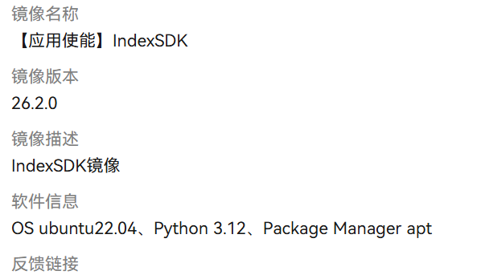

# 【MindSDK】基于IndexSDK完成检索算法验证任务 总结报告

> **一句话结论**：是，完成任务；关键阻塞点：有，文档要素过多，不易操作。

## 1 文档信息

| 项目 | 内容 |
| --- | --- |
| 文档类型 | 验证报告 |
| 提交人 | GitCode ID：gcw_PA6xeC0u |
| 文档版本 / 日期 | v1 / 2026-11-20 |

## 2 任务背景与目标

- **任务目标**：1、下列任务的关键步骤注意记录，输出体验报告。体验报告与issue参与MeetUp优秀开发者激励评价。
2、进入容器环境，检查环境是否正常
npu-smi info #查看卡是否可用
export PATH=/usr/local/python3.12.15/bin:$PATH #设置正确的python版本

3、注意后续文档都是基于master分支的，对于文档有易用性问题欢迎提交issue。
4、参考安装部署指南中的源码安装方式构建run包，注意不需要ILFlat算法（容器中依赖已安装好），并完成重装。
5、参考文档https://gitcode.com/Ascend/IndexSDK/blob/master/docs/zh/03_quick_start.md ，完成Flat算子生成，用例编译并跑通Flat检索用例，
6、阅读文档API中Int8Flat检索算法相关文档，完成Int8Flat算子生成（注意生成算子参数）和参考样例运行。

- **任务结果**：是，达成目标；关键阻塞点：有，文档要素过多，不易操作

## 3 环境准备

### 3.1 环境创建步骤

> 按实际创建顺序记录，**每步必须配截图**，截图命名 `NN_内容.png`。

**步骤 1：申请 / 创建算力环境**

- 操作：HiDevLab+ A2  + NPU卡数 1 
- 截图：

**步骤 2：选择镜像**

- 操作：A2 IndexSDK
- 截图：

**步骤 3：启动并登录开发环境**

- 操作：启动并登录开发环境
- 截图：

### 3.2 环境信息

**截图**： 

## 4 实际执行步骤

- **任务入口文档**：(https://docs.qq.com/doc/DS0VMVndERHR1T2xT)
- **样例 / 代码路径**：(https://gitcode.com/Ascend/IndexSDK/blob/master/docs/zh/03_quick_start.md)
- **是否修改样例代码**：否 

### 步骤 1：容器中执行npu-smi info命令检查驱动是否挂载正常

    <命令>

- **实际**：成功 
- **截图**：

### 步骤 2：算子生成

    <命令>

- **实际**：成功
- **截图**：   

> 步骤按实际执行顺序编号，命令保持原样、不改写、不美化；**每步必须配截图**。

## 5 执行结果

- **结论**：通过
- **判据**：如任务正常结束、输出完整且无异常栈

关键输出（日志原文或截图，二选一）：

    

## 6 发现的问题

> 若发现问题，请提交 issue 并在本节列出链接；未发现则写「本次未发现问题」并说明覆盖范围。

| 问题 | 提交 issue |
| --- | --- |
| 本次未发现问题 |

## 7 总结

 结论： IndexSDK 是基于 Faiss 的昇腾 NPU 异构检索加速框架，Flat 与 Int8Flat 是其面向大规模数据集的核心全量检索算法。

## 8 体验总结

| 维度 | 评价 | 说明 |
| --- | --- | --- |
| 文档易懂度 |  一般 | 能 |
| 流程顺畅度 | 好 | readme报告读写 |
| 报错可读性 | 好 | 报错能指向根因，能误导排查方向 |
| 整体评价 | 5 / 5 | |

