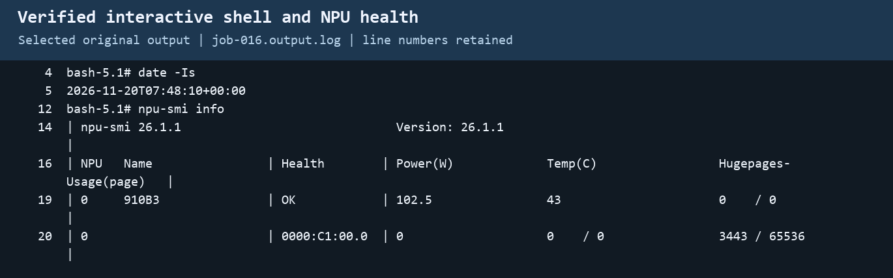
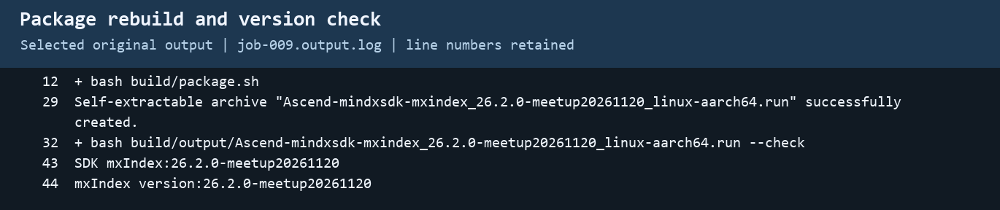
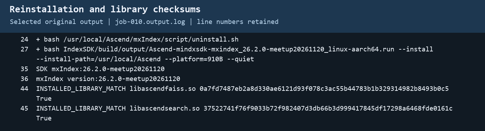
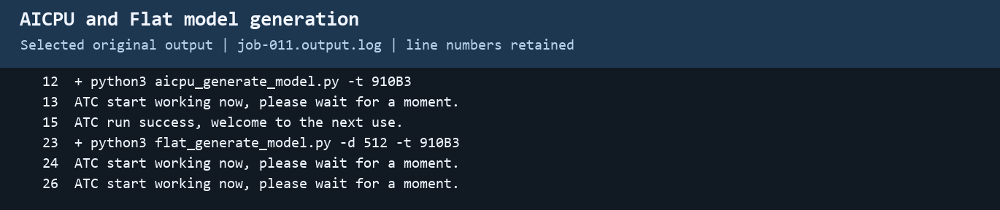
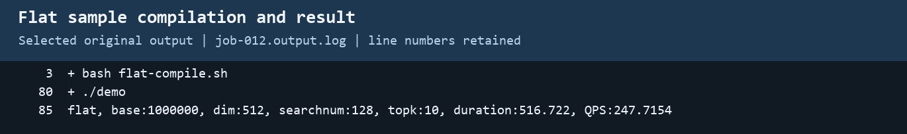
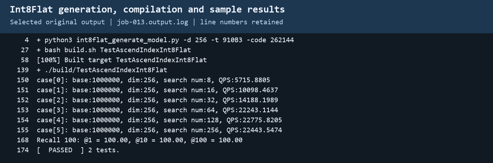
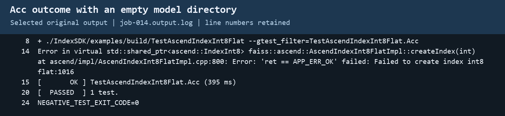

# 【MeetUp】基于 IndexSDK 完成检索算法验证 总结报告

在单卡 Ascend 910B3 上完成 IndexSDK 源码构建、重装和两种检索样例验证。Flat 实测 **247.7154 QPS**。Int8Flat 六组均完成，最高 **22775.8205 QPS**。8 个自检索查询的 Recall@1、@10、@100 均为 **100%**。构建一度因仓库外版本配置缺失生成空版本包，补齐本地版本配置后重新打包并校验通过。

## 1 文档信息

| 项目 | 内容 |
| --- | --- |
| 文档类型 | Meetup 实操验证报告 |
| 提交人 | GitCode ID `gcw_ai2p0Od5` |
| 版本与日期 | v1 / 2026-11-20 |
| 验证源码 | [`99c64b7d04f29f6a056e7c795424f64236b8e389`](https://gitcode.com/Ascend/IndexSDK/commit/99c64b7d04f29f6a056e7c795424f64236b8e389) |

## 2 任务背景与目标

使用预装依赖的 IndexSDK 镜像，从 `master` 源码构建不含 ILFlat 的 `.run` 包并重装。完成 Flat 与 Int8Flat 算子生成，编译并运行文档和仓库中的检索样例。两种样例使用原有算法代码，构建工作区仅按要求关闭 ILFlat 并补齐本地打包所需的版本配置。

[源码安装指南](https://gitcode.com/Ascend/IndexSDK/blob/99c64b7d04f29f6a056e7c795424f64236b8e389/docs/zh/04_installation_guide.md) · [Flat 快速入门](https://gitcode.com/Ascend/IndexSDK/blob/99c64b7d04f29f6a056e7c795424f64236b8e389/docs/zh/03_quick_start.md) · [样例构建说明](https://gitcode.com/Ascend/IndexSDK/blob/99c64b7d04f29f6a056e7c795424f64236b8e389/examples/README.md) · [Int8Flat 样例](https://gitcode.com/Ascend/IndexSDK/blob/99c64b7d04f29f6a056e7c795424f64236b8e389/examples/TestAscendIndexInt8Flat.cpp)

## 3 环境准备

在 HiDevLab 选择昇腾 A2 单卡规格及【应用使能】IndexSDK 26.2.0 镜像，启动容器后通过 SSH 登录。容器为 Linux aarch64，单卡 Ascend 910B3，HBM 65536 MB，`npu-smi` 显示设备状态为 `OK`。环境使用 CANN 9.2.0、Python 3.12.15、Faiss 1.10.0、CMake 3.24.0 和 G++ 11.4.0。

环境创建和镜像选择的原图在本地验收材料中。公开图件按原日志行号展示选定的执行输出。登录提示符来自验证结束后在同一已认证会话中补录的交互式终端。

## 4 实际执行步骤

### 4.1 获取源码并构建

从 `master` 克隆并核对提交。按任务要求在构建配置中排除 ILFlat，选择镜像已安装的 Faiss 1.10 ABI，在仓库根目录运行 `bash build/build.sh`。构建完成，但外部 `ci/config/config.ini` 缺失，首次打包生成了空版本文件名，包内两个版本字段也为空。

### 4.2 修正版本配置并重装

补齐 `ci/config/config.ini` 后用 `bash build/package.sh` 重新打包，使用本次验证的本地构建标签 `26.2.0-meetup20261120`。对 `.run` 执行 `--check`，确认完整性及版本字段。备份旧安装后卸载并重装，安装后的 `libascendfaiss.so` 和 `libascendsearch.so` 均与源码构建归档 SHA-256 一致。

### 4.3 生成 AICPU 和 Flat 算子并运行样例

在安装目录下的 `tools` 中执行 `python3 aicpu_generate_model.py -t 910B3` 和 `python3 flat_generate_model.py -d 512 -t 910B3`，部署生成的模型。按快速入门原样提取 `demo.cpp` 和编译命令，执行 `bash flat-compile.sh` 与 `./demo`。100 万条 512 维底库、128 条查询、TopK 10，累计检索耗时 516.722 ms。

### 4.4 生成 Int8Flat 算子并运行样例

执行 `python3 int8flat_generate_model.py -d 256 -t 910B3 -code 262144`，部署模型后在仓库 `examples` 目录执行 `bash build.sh TestAscendIndexInt8Flat` 和 `./build/TestAscendIndexInt8Flat`。编译成功，QPS 和 Acc 两项正常用例均输出完整结果。

### 4.5 验证模型缺失时的测试结果

保持正常模型目录完好，临时将 `MX_INDEX_MODELPATH` 指向独立空目录，只执行 `--gtest_filter=TestAscendIndexInt8Flat.Acc`。实测出现索引创建错误码 1016，未输出 Recall，GTest 仍显示 `PASSED`，退出码为 0。

## 5 执行结果

| 检查项 | 判据与实际结果 |
| --- | --- |
| 源码构建与重装 | 带版本号的 `.run` 通过校验，两份安装后核心库的哈希值一致 |
| Flat | 100 万底库，512 维，128 查询，TopK 10，516.722 ms，247.7154 QPS |
| Int8Flat QPS | 100 万底库，256 维，L2，TopK 128，六档查询批量均输出正 QPS |
| Int8Flat Acc | 8 个自检索查询中，CPU 参考最近邻 ID 在 NPU 返回 top-k 中的命中率 @1、@10、@100 均为 100% |

| Int8Flat 查询批量 | QPS |
| ---: | ---: |
| 8 | 5715.8805 |
| 16 | 10098.4637 |
| 32 | 14188.1989 |
| 64 | 22243.1144 |
| 128 | 22775.8205 |
| 256 | 22443.5474 |

## 6 发现的问题

| 现象 | 证据 | Issue |
| --- | --- | --- |
| Int8Flat 样例头部注释使用 Flat 模型生成器 | 根据固定提交源码静态核对 | [已有 #217](https://gitcode.com/Ascend/IndexSDK/issues/217) |
| Acc 在空模型目录下打印索引创建异常，仍报告 GTest 通过 | 在 910B3 实测复现，退出码 0 | [本次提交 #218](https://gitcode.com/Ascend/IndexSDK/issues/218) |
| 独立构建缺少仓库外版本配置时，打包仍成功并生成空版本包 | 实际生成并检查空版本包。修正配置后使用新包重装 | [已有 #216](https://gitcode.com/Ascend/IndexSDK/issues/216) |

## 7 总结

完成源码重装、Flat 和 Int8Flat 的正常检索验证，交付安装包及 154 个模型文件已在本地校验。空模型目录验证发现 Acc 状态与实际运行结果不一致，问题已提交。指导老师的现场验收待确认。

## 8 体验总结

| 维度 | 评价 | 说明 |
| --- | --- | --- |
| 文档易懂度 | 一般 | 快速入门样例可直接使用，源码安装指南需要说明独立构建的版本配置，Int8Flat 样例注释需要改成对应的生成脚本 |
| 流程顺畅度 | 一般 | 镜像依赖齐全。Int8Flat 算子生成及部署约 10 分 57 秒，是已计时技术步骤中用时最长的一项 |
| 报错可读性 | 差 | 包版本读取错误和 Acc 索引创建异常之后均继续报告成功，容易误判 |
| 整体评价 | 3/5 | 文档能够引导完成两种算法验证，补齐版本前置条件和失败断言后更适合独立操作 |
