# 【MindSDK】基于IndexSDK完成检索算法验证 总结报告

> **一句话结论**：达成目标——按安装指南源码构建run包（不含ILFlat）并重装后，Flat与Int8Flat两组用例全部PASSED，Recall@1/@10/@100均为100.00；关键阻塞点：无外部阻塞，卡点集中在"算子维度与生成参数"（已提4个issue）；关键指标：Int8Flat QPS峰值23132.05（底库100万×256维，search num=256，单卡910B3）。

## 1 文档信息

| 项目 | 内容 |
| --- | --- |
| 文档类型 | 验证报告 |
| 提交人 | GitCode ID：songnian1 |
| 文档版本 / 日期 | v1 / 2026-11-20 |

## 2 任务背景与目标

- **任务目标**：在Atlas 800I A2（910B3单卡）容器内，仅依据官方文档完成「源码构建run包（不含ILFlat）→重装→Flat算子生成+Flat用例跑通→Int8Flat算子生成+Int8Flat用例跑通」。
- **任务结果**：达成。关键阻塞点：无；文档/示例侧发现4个问题，已全部提issue（#220~#223）。
- **关键指标**：
  - Flat用例：`1 test PASSED`，Recall@1/@10/@100=100.00，耗时4049ms
  - Int8Flat用例：`2 tests PASSED`，Recall@1/@10/@100=100.00，QPS5864.73→23132.05（search num8→256）
  - run包：`Ascend-mindxsdk-mxindex_master-99c64b7_linux-aarch64.run`，23,313,783字节，SHA256 `2c3c18b3…c327d06da`

## 3 环境准备

### 3.1 环境创建步骤

> 环境由平台侧创建后通过SSH进入容器操作。平台创建页与镜像选择页的截图未留存，本节改用容器内可核验的证据替代（`version.info`、`npu-smi`、`os-release`），均可复现。

**步骤 1：申请/创建算力环境**

- 操作：Atlas 800I A2实例，1张910B3，HBM 65536MB（`npu-smi info`读数）
- 截图：

  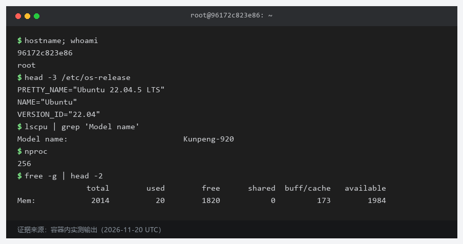

**步骤 2：选择镜像**

- 操作：镜像【应用使能】IndexSDK，容器内预装`mxIndex 26.2.0`、CANN 9.2.0
- 截图：

  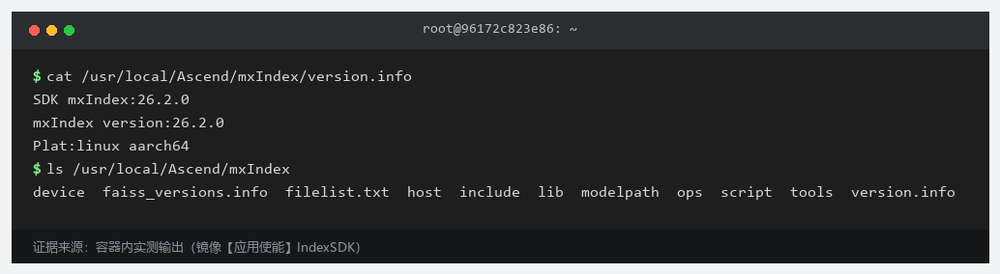

**步骤 3：启动并登录开发环境**

- 操作：SSH登录容器（hostname `96172c823e86`），确认NPU可见
- 截图：

  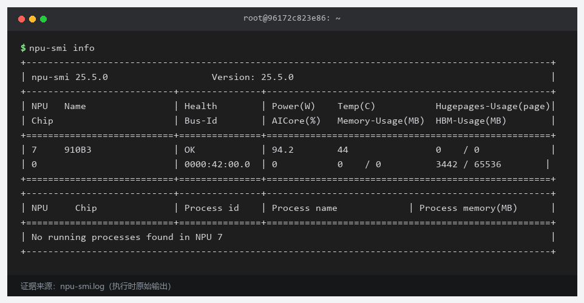

### 3.2 环境信息

```text
+------------------------------------------------------------------------------------------------+
| npu-smi 25.5.0                   Version: 25.5.0                                               |
+---------------------------+---------------+----------------------------------------------------+
| NPU   Name                | Health        | Power(W)    Temp(C)           Hugepages-Usage(page)|
| Chip                      | Bus-Id        | AICore(%)   Memory-Usage(MB)  HBM-Usage(MB)        |
+===========================+===============+====================================================+
| 7     910B3               | OK            | 94.2        44                0    / 0             |
| 0                         | 0000:42:00.0  | 0           0    / 0          3442 / 65536        |
+===========================+===============+====================================================+
| No running processes found in NPU 7                                                            |
+------------------------------------------------------------------------------------------------+
```

| 项目 | 值 |
| --- | --- |
| 设备 | Atlas 800I A2，910B3×1，单卡显存65536MB |
| 操作系统 | Ubuntu 22.04.5 LTS |
| CPU/内存 | Kunpeng-920，256核；内存2014GB |
| CANN | 9.2.0 |
| 预装mxIndex | 26.2.0（`/usr/local/Ascend/mxIndex/version.info`） |
| Python | 3.12.15（`/usr/local/python3.12.15`） |
| 编译器 | gcc 11.4.0 |

## 4 实际执行步骤

- **任务入口文档**：https://gitcode.com/Ascend/IndexSDK/blob/master/docs/zh/03_quick_start.md
- **安装指南**：https://gitcode.com/Ascend/IndexSDK/blob/master/docs/zh/04_installation_guide.md （源码安装章节）
- **样例/代码路径**：https://gitcode.com/Ascend/IndexSDK/blob/master/examples/TestAscendIndexInt8Flat.cpp
- **是否修改样例代码**：否。仅按任务要求修改了`feature_retrieval/src/ascendfaiss/CMakeLists.txt`两处以关闭ILFlat（`BUILD_ASCENDDEVICE=OFF`、注释`ASCEND_MINIOS_HOME`），改动可`git checkout`回退，diff见`04_build_config.png`。

### 步骤 1：环境与设备检查

```bash
npu-smi info
export PATH=/usr/local/python3.12.15/bin:$PATH
python3 -V
```

- **预期**：NPU正常可见，Python版本为3.12.15
- **实际**：成功。`npu-smi`显示910B3、HBM 3442/65536MB占用，无残留进程
- **截图**：

  

  

  

### 步骤 2：源码构建run包（关闭ILFlat）

```bash
cd /workspace/indexsdk-verification-DiIdOb/src
# 按 04_installation_guide.md 源码安装章节，关闭开放态（ILFlat）相关构建
sed -i 's/^OPTION(BUILD_ASCENDDEVICE.*/OPTION(BUILD_ASCENDDEVICE "Build ascenddevice" OFF)/' feature_retrieval/src/ascendfaiss/CMakeLists.txt
sed -i '38s/^\([[:space:]]*\)ASCEND_MINIOS_HOME/\1# ASCEND_MINIOS_HOME/' feature_retrieval/src/ascendfaiss/CMakeLists.txt

bash build/build.sh
```

- **预期**：在`build/output`下产出`Ascend-mindxsdk-mxindex_{version}_linux-aarch64.run`，包内仅含310P/910B/Ascend950三套算子包
- **实际**：成功。产出`Ascend-mindxsdk-mxindex_master-99c64b7_linux-aarch64.run`（23,313,783字节），压缩数据22844KB，内含`Ascend-featureretrieval__gcc7.3.0-linux-aarch64-{310P,910B,Ascend950}.tar.gz`
- **截图**：

  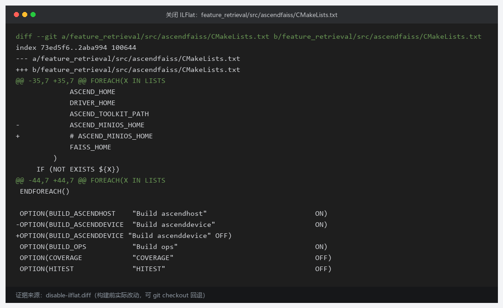

  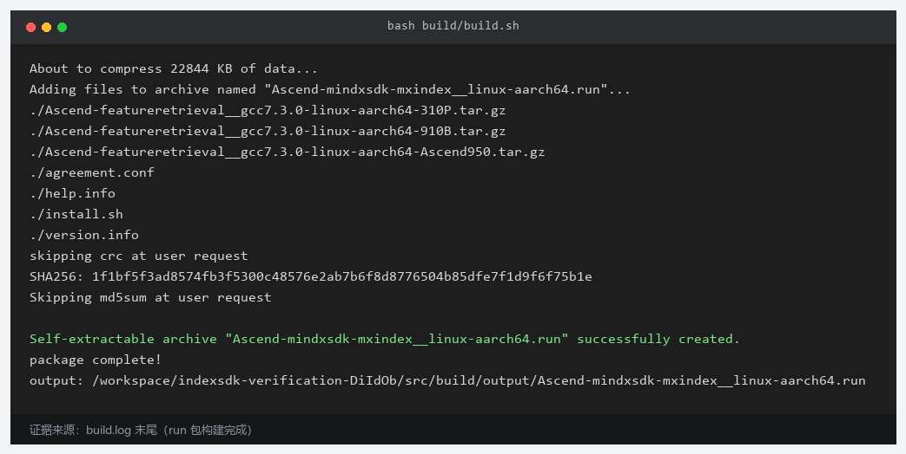

### 步骤 3：安装run包并替换预装版本

```bash
./Ascend-mindxsdk-mxindex_master-99c64b7_linux-aarch64.run --install --platform=910B --install-path=/workspace/indexsdk-verification-DiIdOb/install
```

- **预期**：安装目录出现`mxIndex-master-99c64b7`，`mxIndex`软链指向它
- **实际**：成功。`Install package successfully`，`mxIndex -> mxIndex-master-99c64b7`
- **截图**：

  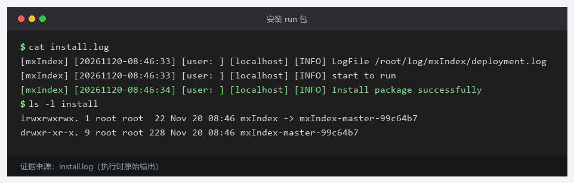

### 步骤 4：生成Flat算子

```bash
cd /workspace/indexsdk-verification-DiIdOb/install/mxIndex/tools
export MX_INDEX_MODELPATH=/workspace/indexsdk-verification-DiIdOb/models
python3 aicpu_generate_model.py -t 910B3
python3 flat_generate_model.py -d 256 -t 910B3
mv op_models/* $MX_INDEX_MODELPATH
```

- **预期**：生成256维Flat算子并落到`MX_INDEX_MODELPATH`
- **实际**：成功。最终`models/`累计232个`.om`（Flat与Int8Flat合并，文件名均含`_256_`）
- **说明**：维度取256而非快速入门默认的512，原因是用例`TestAscendIndexFlat.cpp:161`写死`int dim = 256`，此不一致已提issue #223。该步骤无独立日志留存，算子可用性由步骤6用例成功佐证

### 步骤 5：编译examples

```bash
cd /workspace/indexsdk-verification-DiIdOb/src/examples
bash build.sh
```

- **预期**：生成`TestAscendIndexFlat`与`TestAscendIndexInt8Flat`两个可执行文件
- **实际**：成功。`Built target TestAscendIndexFlat`、`Built target TestAscendIndexInt8Flat`，链接到`install/mxIndex/host/lib/libascendfaiss.so`
- **截图**：

  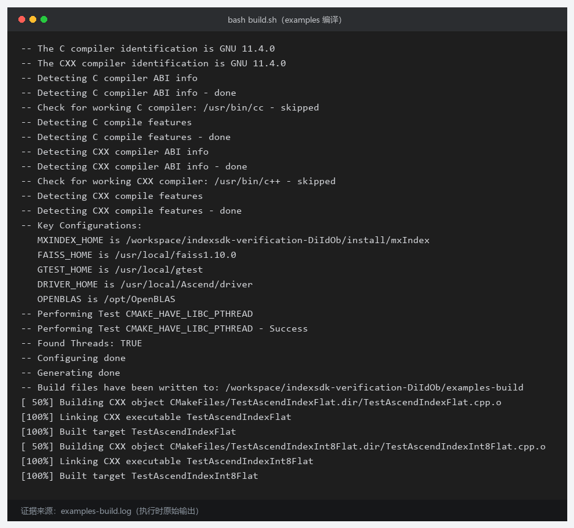

### 步骤 6：运行Flat用例

```bash
./TestAscendIndexFlat --gtest_filter=TestAscendIndexFlat.Acc
```

- **预期**：用例PASSED，CPU/NPU召回一致
- **实际**：成功。`[  PASSED  ] 1 test.`，Recall@1/@10/@100=100.00，耗时4049ms（底库100万×256维）
- **截图**：

  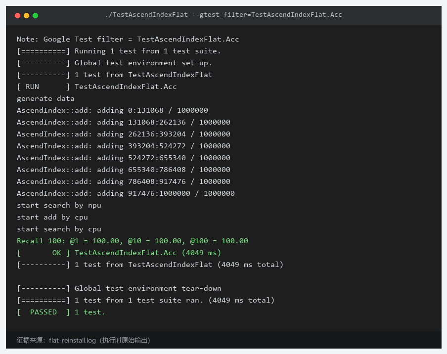

### 步骤 7：生成Int8Flat算子

```bash
cd /workspace/indexsdk-verification-DiIdOb/master-opgen
python3 int8flat_generate_model.py -d 256 -t 910B3 -code 262144
```

- **预期**：生成Int8Flat所需的4类算子（`AscendcDistInt8FlatL2/Cos`、`AscendcDistanceInt8CosMaxsWithMask`、`AscendcL2Norm`）
- **实际**：成功。4次`ATC run success`，`op_models/`产出4个`.om`，合并入`models/`
- **截图**：

  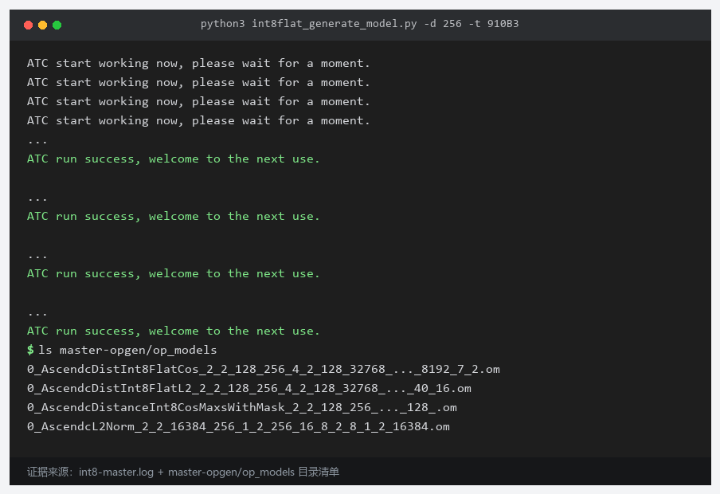

### 步骤 8：运行Int8Flat用例

```bash
./TestAscendIndexInt8Flat
```

- **预期**：`QPS`与`Acc`两个用例PASSED，召回与CPU一致
- **实际**：首次运行（未生成Int8Flat算子时）报`Failed to create index int8 flat:1016`却仍输出`PASSED`，属示例吞异常导致的假通过，见`10_int8_baseline.png`与issue #222；生成算子后重跑，`[  PASSED  ] 2 tests.`，QPS 5864.73→23132.05，Recall@1/@10/@100=100.00
- **截图**：

  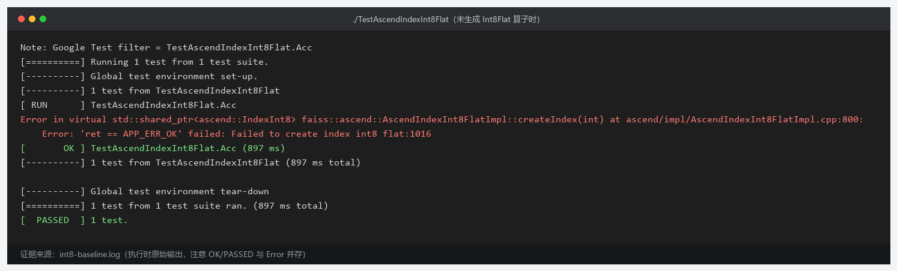

  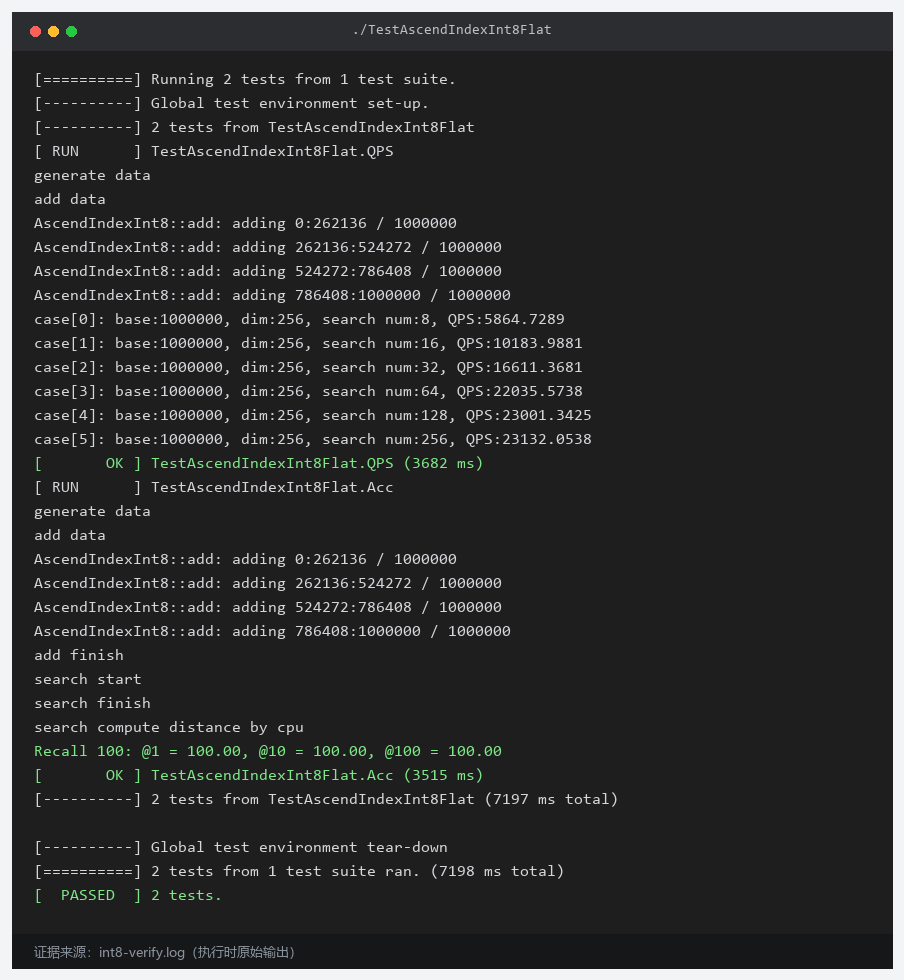

## 5 执行结果

- **结论**：通过
- **判据**：两个用例二进制均正常结束；gtest汇总为`PASSED`且无未捕获异常栈；召回与CPU暴力计算一致（Recall@100=100.00）；`npu-smi`无残留进程

关键输出：

```text
[==========] 1 test from 1 test suite ran. (4049 ms total)
[  PASSED  ] 1 test.

case[0]: base:1000000, dim:256, search num:8, QPS:5864.7289
case[1]: base:1000000, dim:256, search num:16, QPS:10183.9881
case[2]: base:1000000, dim:256, search num:32, QPS:16611.3681
case[3]: base:1000000, dim:256, search num:64, QPS:22035.5738
case[4]: base:1000000, dim:256, search num:128, QPS:23001.3425
case[5]: base:1000000, dim:256, search num:256, QPS:23132.0538
Recall 100: @1 = 100.00, @10 = 100.00, @100 = 100.00
[  PASSED  ] 2 tests.
```

## 6 发现的问题

| 问题 | 提交issue |
| --- | --- |
| 同一台910B3，快速入门要求`-t 910B3`（完整Name），安装指南要求`--platform=910B`（去末位），两个参数同名不同规则，按安装习惯生成算子必失败 | [#220](https://gitcode.com/Ascend/IndexSDK/issues/220) |
| 镜像预装mxIndex 26.2.0与master源码存在API漂移，直接用master examples编译镜像库会报C++错误，文档未给"源码tag↔run包版本"对应关系 | [#221](https://gitcode.com/Ascend/IndexSDK/issues/221) |
| `TestAscendIndexInt8Flat`捕获`createIndex`异常后不判失败，算子缺失时报1016却输出`PASSED`、退出码0，构成假通过 | [#222](https://gitcode.com/Ascend/IndexSDK/issues/222) |
| 快速入门默认`-d 512`，examples用例写死`dim=256`；INT8Flat参数表`npu_type`默认310P却不在支持列表、`code_num`默认值与"生成全部"互斥 | [#223](https://gitcode.com/Ascend/IndexSDK/issues/223) |

## 7 总结

1. 源码构建链路可用：master源码（`99c64b7`）关闭ILFlat后`bash build/build.sh`一次通过，产出的run包重装后examples编译与运行均正常，说明"源码安装"路径本身是通的。
2. 检索功能达标：Flat与Int8Flat在100万×256维底库上Recall@100均为100.00；Int8Flat单卡QPS从5864.73（search num=8）升至23132.05（search num=256），随批量增大趋近饱和。
3. 真正的门槛不在编译，而在"生成什么算子"：维度（256 vs 512）与`npu_type`（910B3 vs 910B）两处口径不一致，且用例会把失败吞成PASSED，导致问题被发现的时间被显著推后——这三点已分别提为#223与#222。

## 8 体验总结

| 维度 | 评价 | 说明 |
| --- | --- | --- |
| 文档易懂度 | 一般 | 安装、算子生成、用例执行三段结构清晰，但"安装参数"与"生成参数"同名字不同规则，且默认维度与示例不一致，无法只看文档一次做对 |
| 流程顺畅度 | 一般 | 构建→安装→生成→编译→运行链路顺畅；最费时的是算子生成，最易错的是维度与`-t`取值 |
| 报错可读性 | 差 | `input invalid npu_type`只列合法值不提示区别；`Failed to create index int8 flat:1016`只有错误码没有释义；示例还把这类失败吞成PASSED |
| 整体评价 | 4 / 5 | 能力完整、性能符合预期，扣分主要在文档口径与示例健壮性 |

- **最耗时的一步**：步骤7~8（Int8Flat算子生成到用例跑通），从Flat用例结束（08:47）到Int8Flat用例通过（08:56），约9分钟
- **最值得改进的点**：把"算子维度/`npu_type`取值"从散落在多份文档的隐性约定，收敛成示例代码顶部一行可复制的生成命令；同时让示例在`createIndex`失败时真的失败
