# 【MeetUp】基于 IndexSDK 完成检索算法验证任务 总结报告

**技术验证通过。** 在 HiDevLab 昇腾 A2 单卡环境从源码构建、校验并安装了 IndexSDK。Flat 完成百万条向量入库与检索，Int8Flat 的吞吐和准确性两个用例均通过。首次批量生成 Flat 模型时有两个 ATC 进程被内存限制终止，单独补编后取得了该组全部 16 个 L2 模型。

## 1 文档信息

| 项目 | 内容 |
| --- | --- |
| 文档类型 | Meetup 实操验证与体验报告 |
| 提交人 | `weixin_71891897` |
| 版本及日期 | v1.0 / 2026-11-20 |
| 代码仓库与版本 | `Ascend/IndexSDK` 的 `master`，提交 `99c64b7d04f29f6a056e7c795424f64236b8e389` |
| 验收现状 | 技术验证通过，环境与登录证据已附，两条 Issue 复现补充已发布，活动验收待完成 |

## 2 任务背景与目标

IndexSDK 用昇腾 NPU 加速向量检索。向量是由一组数字表示的特征，检索就是在底库中找与查询向量最相似的若干条记录。此次任务验证开发者能否在指定镜像中从源码打包和安装 SDK，并在真实 NPU 上跑通 Flat 的浮点内积检索，以及 Int8Flat 的 8 位整数向量 L2 距离检索。 [Meetup 实操任务书](https://docs.qq.com/doc/DS0VMVndERHR1T2xT?nlc=1)

完成判据是源码包通过校验并安装到实操目录，两种算子按样例所需参数生成，Flat 实际完成检索，Int8Flat 输出完整的六组吞吐结果和 CPU 对照结果。

## 3 环境准备

### 3.1 创建、选镜像和登录

| 步骤 | 操作记录 | 验收证据 |
| --- | --- | --- |
| 1. 申请并创建算力环境 | 使用 HiDevLab 实例 `DevEnv_318090`。规格为昇腾 A2，1 张 NPU、32 GB 内存、32 核 CPU、300 GB 存储，挂载目录为 `/workspace`。 | [实例列表截图](01_env_create.png) |
| 2. 选择镜像 | 任务指定「【应用使能】IndexSDK」。配置图显示通过自定义镜像填入昇腾镜像仓库的 IndexSDK 26.2.0 镜像，实例列表显示其 CANN 版本为 9.2.0。 | [镜像和单卡规格截图](02_env_image.png) |
| 3. 启动并登录 | 通过 HiDevLab 提供的 SSH 直连进入容器。重新连接后核对 `/workspace/meetup-indexsdk` 和验收文件，输出 `[  PASSED  ] 2 tests.`。 | [SSH 实测终端输出图](03_env_login.png) · [终端记录](03-SSH实际登录.log) |


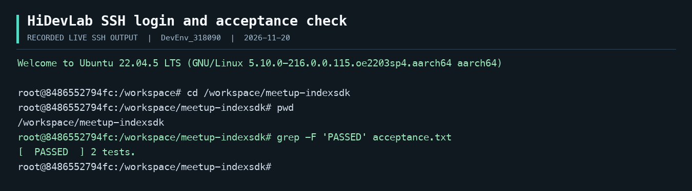

### 3.2 环境检查

```bash
npu-smi info
export PATH=/usr/local/python3.12.15/bin:$PATH
python3 --version
```

| 检查项 | 实测情况 |
| --- | --- |
| NPU | `910B3` 单卡，`Health: OK`，表示查询时设备健康检查正常 |
| NPU 显存 | 日志显示 HBM 共 `65536 MB`，检查时已使用约 `3456 MB`。HBM 是卡上的显存，32 GB 是容器的主机内存上限 |
| 操作系统及架构 | Ubuntu 22.04.5 LTS，aarch64 |
| 实操依赖 | Python 3.12.15、CANN 9.2.0、Faiss 1.10.0、CMake 3.24.0 |

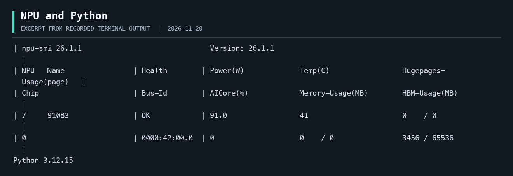

实例和镜像配置图来自本人 HiDevLab 控制台。登录证据图由本次真实 SSH 终端记录生成，后续执行证据图来自实际运行日志。 [环境日志摘录](01-环境与源码.log)

## 4 实际执行步骤

样例使用实际检出的官方源码。Flat 直接采用快速入门里的 C++ 示例，Int8Flat 使用 `examples/TestAscendIndexInt8Flat.cpp`。为选择构建范围和限制内存用量，调整了本地 checkout 的构建配置和编译并发。 [安装部署指南](https://gitcode.com/Ascend/IndexSDK/blob/master/docs/zh/04_installation_guide.md) · [Flat 快速入门](https://gitcode.com/Ascend/IndexSDK/blob/master/docs/zh/03_quick_start.md) · [Int8Flat 样例源码](https://gitcode.com/Ascend/IndexSDK/blob/99c64b7d04f29f6a056e7c795424f64236b8e389/examples/TestAscendIndexInt8Flat.cpp)

### 步骤 1　拉取并构建安装包

```bash
cd /workspace/meetup-indexsdk
git clone --depth 1 -b master https://gitcode.com/Ascend/IndexSDK.git
cd IndexSDK
git rev-parse HEAD
sed -i 's/^OPTION(BUILD_ASCENDDEVICE.*/OPTION(BUILD_ASCENDDEVICE "Build ascenddevice" OFF)/; /^[[:space:]]*ASCEND_MINIOS_HOME[[:space:]]*$/s/ASCEND_MINIOS_HOME/# ASCEND_MINIOS_HOME/' feature_retrieval/src/ascendfaiss/CMakeLists.txt
sed -i -E 's/make -j( |$)/make -j12\1/' feature_retrieval/build/build.sh vstar_great_impl/mix-index/publish_union.sh
export CMAKE_BUILD_PARALLEL_LEVEL=12 BUILD_JOBS=12
bash build/build.sh
```

**预期**按要求关闭 ILFlat 相关的设备端构建并生成 aarch64 安装包。**实际**成功生成约 23 MB 的 `Ascend-mindxsdk-mxindex__linux-aarch64.run`。外部版本配置缺失，包名中的版本字段为空。 [构建日志摘录](02-源码构建.log)

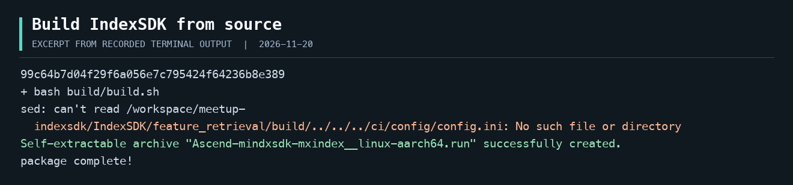

### 步骤 2　校验并安装新包与自定义算子

```bash
cd /workspace/meetup-indexsdk/IndexSDK
pkg=build/output/Ascend-mindxsdk-mxindex__linux-aarch64.run
bash "$pkg" --check
sha256sum "$pkg"
bash "$pkg" --list | grep 910B
source /usr/local/Ascend/cann/set_env.sh
bash /workspace/meetup-indexsdk/IndexSDK/build/output/Ascend-mindxsdk-mxindex__linux-aarch64.run --install --quiet --install-path=/workspace/meetup-indexsdk/install --platform=910B
cd /workspace/meetup-indexsdk/install/mxIndex/ops
bash ./custom_opp_aarch64.run
```

**预期**归档完整、包含 910B 安装文件，SDK 和算子安装成功。**实际**校验返回 0，包内包含 910B 文件。安装全部成功，新 SDK 可经 `/workspace/meetup-indexsdk/install/mxIndex` 访问。 [包校验日志摘录](03-安装包校验.log) · [安装日志摘录](04-安装新包与算子.log)

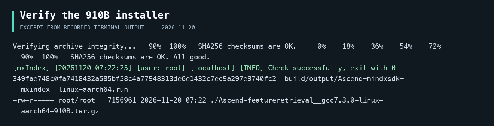
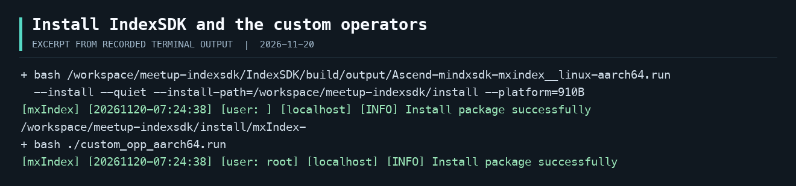

### 步骤 3　生成 AICPU 和 Flat 模型并编译样例

```bash
cd /workspace/meetup-indexsdk/install/mxIndex/tools
python3 aicpu_generate_model.py -t 910B3
python3 flat_generate_model.py -d 512 -t 910B3 -pool 4
```

**预期**生成 910B3 的 AICPU 和 512 维 Flat 模型。**实际**AICPU 成功，15 个内积模型全部生成。两路 ATC 进程被容器内存限制终止，首轮 Flat 生成脚本退出状态为 1，L2 模型随后补编。ATC 把算子配置编译为可在指定 NPU 上加载的 `.om` 模型文件。 [AICPU 与 Flat 算子日志摘录](05-AICPU与Flat算子.log)

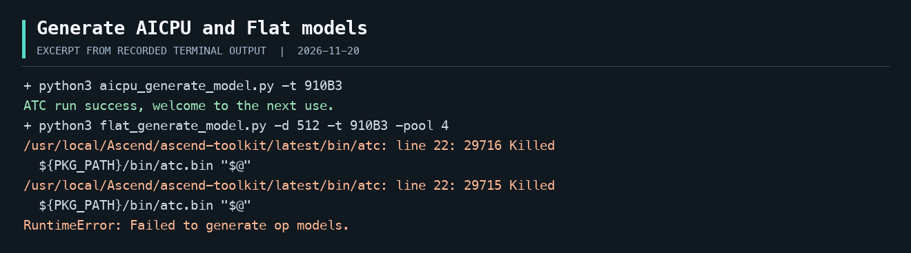

与模型生成并行，用官方示例编译了两个可执行文件。编译和动态链接检查均通过，两个样例使用本次构建的 SDK。生成模型、编译及运行的各个终端会话都先加载 CANN 和运行库路径。

```bash
base=/workspace/meetup-indexsdk
sdk=$base/install/mxIndex
source /usr/local/Ascend/cann/set_env.sh
export PATH=/usr/local/python3.12.15/bin:$PATH
export LD_LIBRARY_PATH="$sdk/host/lib:/usr/local/faiss/lib:/usr/local/gtest/lib:/opt/OpenBLAS/lib:/usr/local/Ascend/driver/lib64:/usr/local/Ascend/driver/lib64/driver:/usr/local/python3.12.15/lib:$LD_LIBRARY_PATH"
export MX_INDEX_MODELPATH="$base/models" OMP_NUM_THREADS=8 OPENBLAS_NUM_THREADS=1
```

```bash
g++ --std=c++11 -fPIC -fPIE -fstack-protector-all -Wall -D_FORTIFY_SOURCE=2 -O3 -Wl,-z,relro,-z,now,-z,noexecstack -s -pie -o /workspace/meetup-indexsdk/samples/flat-demo /workspace/meetup-indexsdk/samples/flat-demo.cpp -I/workspace/meetup-indexsdk/install/mxIndex/include -I/usr/local/faiss/include -I/usr/local/Ascend/driver/include -I/opt/OpenBLAS/include -L/workspace/meetup-indexsdk/install/mxIndex/host/lib -L/usr/local/faiss/lib -L/usr/local/Ascend/driver/lib64 -L/usr/local/Ascend/driver/lib64/driver -L/opt/OpenBLAS/lib -L/usr/local/Ascend/cann/lib64 -lfaiss -lascendfaiss -lopenblas -lc_sec -lascendcl -lascend_hal -lascendsearch -lock_hmm
cmake -S /workspace/meetup-indexsdk/IndexSDK/examples -B /workspace/meetup-indexsdk/samples/int8-build -DMXINDEX_HOME=/workspace/meetup-indexsdk/install/mxIndex -DFAISS_HOME=/usr/local/faiss1.10.0
cmake --build /workspace/meetup-indexsdk/samples/int8-build --target TestAscendIndexInt8Flat --parallel 4
ldd /workspace/meetup-indexsdk/samples/int8-build/TestAscendIndexInt8Flat | grep libascendfaiss
```

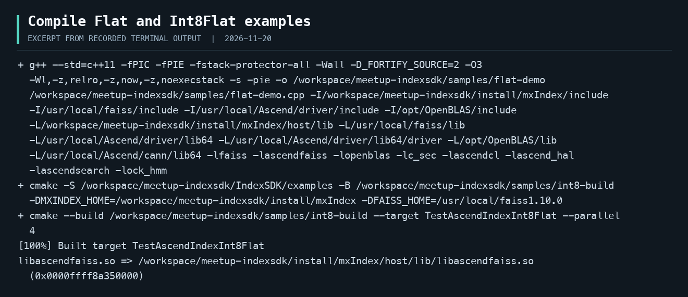

[样例编译日志摘录](06-样例编译.log)

### 步骤 4　运行 Flat 快速入门样例

```bash
export MX_INDEX_MODELPATH=/workspace/meetup-indexsdk/models
cp -a /workspace/meetup-indexsdk/install/mxIndex/tools/op_models/. /workspace/meetup-indexsdk/models/
timeout 180 /workspace/meetup-indexsdk/samples/flat-demo
```

**预期**100 万条向量入库后完成 128 条查询，输出 `search end!`。**实际**样例退出状态为 0，实际输出与样例设置一致。 [Flat 运行日志摘录](07-Flat检索结果.log)

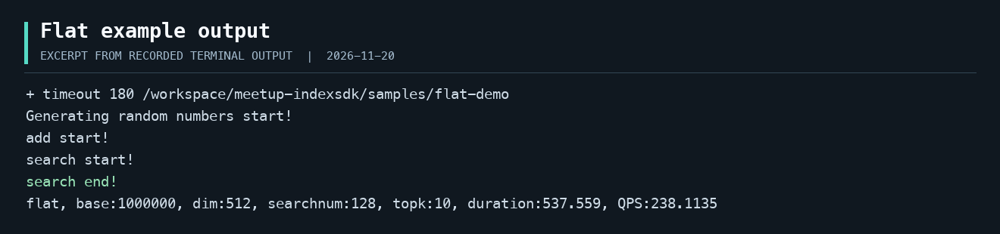

### 步骤 5　按 Int8Flat 样例参数生成模型

初次生成命令覆盖全部分块规格，随后终止该次生成。查阅示例配置后，仅生成默认的 262,144 条分块规格，并把 ATC 并发降为 2。

```bash
cd /workspace/meetup-indexsdk/int8-model-262144
python3 /workspace/meetup-indexsdk/install/mxIndex/tools/int8flat_generate_model.py -d 256 -t 910B3 -code 262144 -pool 2
cp -a op_models/. /workspace/meetup-indexsdk/models/
```

**预期**产出 910B3 可用的 256 维算子模型。**实际**生成 63 个 `.om` 文件，其中 28 个属于 Int8Flat L2 距离模型。 [Int8Flat 算子日志摘录](09-Int8Flat样例算子.log)

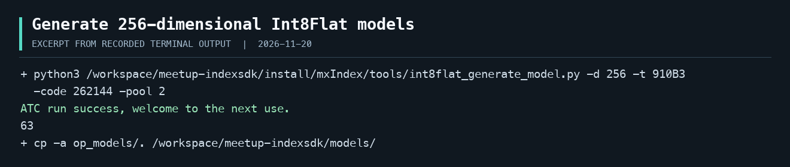

### 步骤 6　运行 Int8Flat 两个用例

```bash
timeout 240 stdbuf -oL -eL /workspace/meetup-indexsdk/samples/int8-build/TestAscendIndexInt8Flat --gtest_color=no
```

**预期**吞吐用例输出六组查询结果，准确性用例给出 CPU 对照结果，测试进程正常退出。**实际**全部输出齐全，两个用例均通过，退出状态为 0。 [Int8Flat 运行日志摘录](11-Int8Flat检索结果.log)

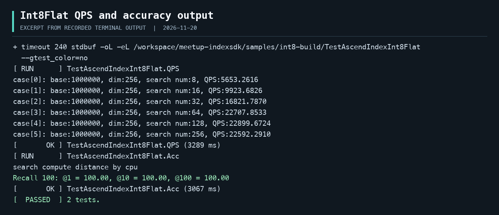

### 步骤 7　补编首轮缺失的 Flat L2 模型

在 Int8Flat 生成期间启动单个 ATC 进程补编，补编在 Int8Flat 样例结束后完成。

```bash
cd /workspace/meetup-indexsdk/install/mxIndex/tools
timeout 600 atc --singleop=./config/distance_flat_l2_op_pid0.json --soc_version=Ascend910B3 --output=op_models --log=error
```

**预期**L2 模型组达到 16 个。**实际**ATC 正常退出，精确核对为 16 个 L2 模型并复制到运行目录。最终模型目录共有 154 个 `.om` 文件，其中 AICPU 和 Flat 共 91 个，Int8Flat 共 63 个。 [Flat L2 补编日志摘录](10-补编Flat-L2模型.log)

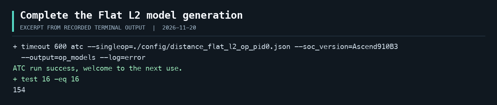

## 5 执行结果与字段解释

### 5.1 环境与安装

| 验收输出 | 含义 |
| --- | --- |
| `910B3` 和 `Health: OK` | 正常识别到可用的昇腾 910B3 NPU，硬件健康状态为正常 |
| `Python 3.12.15` | 当前环境使用任务指定的 Python 版本来生成算子 |
| 两条 `Install package successfully` | 分别表示源码新包和自定义算子安装成功 |
| `SHA256 checksums are OK` | 软件归档内容与其内置的校验值一致，表明该归档通过完整性检查 |

### 5.2 Flat 结果

```text
add start!
search start!
search end!
flat, base:1000000, dim:512, searchnum:128, topk:10, duration:537.559, QPS:238.1135
```

| 字段 | 含义 |
| --- | --- |
| `add start!`、`search start!`、`search end!` | 依次表示开始入库、开始检索、检索完成。官方示例在开始检索前核对底库条数 |
| `base:1000000` | 底库含 100 万条向量 |
| `dim:512` | 每条向量有 512 个数值特征 |
| `searchnum:128` | 一批共提交 128 条查询向量 |
| `topk:10` | 每条查询返回得分排名前 10 的记录。Flat 样例使用内积打分 |
| `duration:537.559` | 这批查询的检索阶段实际耗时 537.559 毫秒，计时范围为 `index.search` |
| `QPS:238.1135` | 每秒处理约 238.11 条查询，用 128 条除以 0.537559 秒得到，是这批查询的吞吐量 |

### 5.3 Int8Flat 结果

`Int8Flat` 的向量分量使用 8 位整数表示，本例使用 256 维向量和 L2 距离。日志中的 `adding 0:262136 / 1000000` 等行记录分批入库的区间，最后一行到达 100 万条。`case[0]` 到 `case[5]` 是同一个 QPS 用例里的六组测试。每组以不同查询批大小执行，计时前预热，计时阶段每组重复检索 10 次。

| case | 每批查询数 `search num` | 实测 QPS（查询向量/秒） |
| --- | ---: | ---: |
| `case[0]` | 8 | 5,653.2616 |
| `case[1]` | 16 | 9,923.6826 |
| `case[2]` | 32 | 16,821.7870 |
| `case[3]` | 64 | 22,707.8533 |
| `case[4]` | 128 | 22,899.6724 |
| `case[5]` | 256 | 22,592.2910 |

这次观察到 128 条/批时吞吐最高，256 条/批时略低。Flat 和 Int8Flat 用例的维度、距离算法、返回条数与计时设置不同，两组 QPS 各自描述对应的样例工作负载。

```text
search compute distance by cpu
Recall 100: @1 = 100.00, @10 = 100.00, @100 = 100.00
[  PASSED  ] 2 tests.
```

| 字段 | 含义 |
| --- | --- |
| `Acc`、`search compute distance by cpu` | 准确性用例用底库前 8 条向量做查询。CPU 逐条计算 L2 距离排序，生成参考结果 |
| `Recall 100` | 每条查询最多检查 NPU 返回的前 100 个结果。这里的第一个 `100` 是候选条数 |
| `@1 = 100.00` | 8 条查询中，CPU 排名第一的结果都在 NPU 排名第 1 位 |
| `@10 = 100.00`、`@100 = 100.00` | 对 8 条查询，CPU 排名第一的结果均出现在 NPU 的前 10 和前 100 个候选中。这是本例的命中率口径 |
| `[ OK ]`、`[ PASSED ] 2 tests.` | GoogleTest 记录 `QPS` 与 `Acc` 两个用例通过。结合六组 QPS 回显和召回率行，确认两个检索流程确实执行完毕 |
| `3289 ms`、`3067 ms`、`6357 ms total` | 分别是 QPS 用例、Acc 用例及套件的总耗时，包含用例内部的数据生成等操作，区别于单次检索耗时 |

**验收判定**为技术验证通过。召回统计只覆盖本次示例的 8 条查询。它统计的是 CPU 首位结果在 NPU 候选列表中的排名。 [指标计算源码](https://gitcode.com/Ascend/IndexSDK/blob/99c64b7d04f29f6a056e7c795424f64236b8e389/examples/TestAscendIndexInt8Flat.cpp) · [Int8Flat 日志摘录](11-Int8Flat检索结果.log)

## 6 发现的问题

| 问题 | 实际现象与建议 | Issue 状态 |
| --- | --- | --- |
| 源码独立构建的包没有版本号 | 仓库外的 `ci/config/config.ini` 缺失。构建仍成功，但包名与包内版本字段为空。建议提供独立构建的版本来源，并明确提示缺失版本的解决方法 | [#216 复现补充](https://gitcode.com/Ascend/IndexSDK/issues/216#tid-202529350)，同一源码提交上独立复现 |
| 32 GB 单卡容器编译 Flat 时触发内存限制 | `-pool 4` 时两个 ATC 进程被杀，首轮报 `Failed to generate op models`。已单进程补编成功。建议文档给出适合单卡容器的并发配置与单组补编方法 | [#219 复现补充](https://gitcode.com/Ascend/IndexSDK/issues/219#tid-202528818)，本次确认 `oom_kill` 由 0 增至 2，单进程补编通过 |

两条 Issue 已由其他参与者提交。本次实操独立复现了相同现象，已在原 Issue 下补充环境和关键输出。

## 7 总结

1. 已用确认健康的 910B3 单卡从源码构建、校验并安装 SDK。Flat 按任务的百万条底库和 128 条查询顺利运行。
2. Int8Flat 在 256 维、百万条底库上完成 6 组吞吐测试与 8 条查询的 CPU 对照。两个用例均通过，三个召回指标均为 100%。
3. 本报告附有关键输出证据图和日志摘录，两条问题的复现证据已补充到原 Issue。报告与附件的提交目标为 `experimental` 分支的 `experimental` 目录，并请活动指导老师验收。 [活动实操说明](https://docs.qq.com/doc/DS3N3Ym1ocHVhcFZm) · [报告提交目录](https://gitcode.com/Ascend/IndexSDK/tree/experimental/experimental)

## 8 体验总结

| 维度 | 评价 | 说明 |
| --- | --- | --- |
| 文档易懂度 | 一般 | 快速入门给出了完整示例。独立打包的版本来源和适合容器的算子生成并发需要补充 |
| 流程顺畅度 | 一般 | 预置环境具备用例依赖。从源码构建及运行均可完成，算子编译占据主要等待时间 |
| 报错可读性 | 一般 | ATC 报 `Killed` 和子进程消失，需结合容器 `oom_kill` 计数才能定位内存上限 |
| 整体评价 | 4 / 5 | 样例覆盖了从编译、安装到设备检索的完整链路，补充版本与内存设置后更容易照文档复现 |

**最耗时的步骤**是 Int8Flat 目标算子生成，按本地日志记录从开始到结束约 11 分钟。**优先改进**是给 A2 单卡实操提供按样例维度、分块参数与内存上限配置的命令，并在编译失败时标明具体需要补编的模型组。
